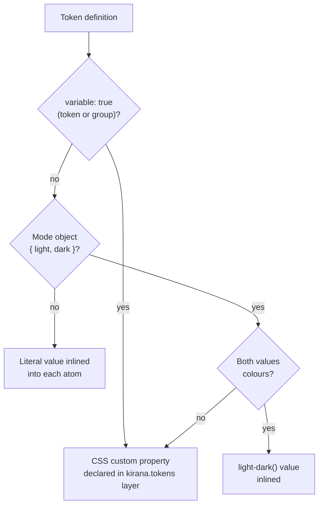

# 07 — Tokens, Themes and Presets

**Owns:** the token model, how tokens become inlined values or CSS variables, token typing without code
generation, colour modes and scoped themes, DTCG import, preset composition, and
`@kirana-style/preset-scales`.
**Depends on:** [00-glossary](./00-glossary.md), [20-decisions](./20-decisions.md) (D-005, D-007, D-009,
D-010, D-035, D-037), [06-authoring-api](./06-authoring-api.md), [08-conditions-and-cascade](./08-conditions-and-cascade.md).

## Principles

- The engine knows no design values (**KRN-TOK-001**: the engine and `@kirana-style/core` MUST ship zero tokens,
  scales, breakpoints and colours; D-005).
- Authors write one token API; a token's own definition decides its representation, never how other
  modules use it (D-035).
- Types flow from the definitions; nothing is generated (D-007).

## Defining tokens

```ts
// tokens.ts — any module
import { defineTokens } from "@kirana-style/core"

export const palette = defineTokens("palette", {
  blue600: "oklch(54.6% 0.245 262.881)",
  orange600: "oklch(64.6% 0.222 41.116)",
  neutral950: "oklch(14.5% 0 0)",
  white: "oklch(100% 0 0)",
})

export const space = defineTokens("space", {
  0: "0px",
  1: "0.25rem",
  1.5: "0.375rem",
  2: "0.5rem",
  4: "1rem",
})

export const theme = defineTokens("theme", {
  background: { light: palette.white, dark: palette.neutral950 }, // a mode token
  primary: palette.blue600, // an alias
  ring: { light: "oklch(70.8% 0 0)", dark: "oklch(55.6% 0 0)", variable: true },
})

// every token of the group is a custom property
export const ctx = defineTokens(
  "ctx",
  { iconSize: "1rem", cardSpacing: "1.5rem" },
  { variable: true }
)
```

| Rule             | Specification                                                                                                                                                                                                                                  |
| ---------------- | ---------------------------------------------------------------------------------------------------------------------------------------------------------------------------------------------------------------------------------------------- |
| Namespace        | The first argument names the group. Together with the owning package name it forms the token identity; duplicates within one package are the `token-namespace-collision` diagnostic.                                                           |
| Value            | A CSS value string, a number, another token (alias), or a mode object `{ light, dark }`.                                                                                                                                                       |
| `variable: true` | Makes the token a CSS custom property. A third argument `{ variable: true }` does so for every token of the group. Only variable tokens can be overridden by a theme or assigned.                                                              |
| Composition      | A value may interpolate tokens: `` `calc(${space[1]} * -1)` ``, `` `color-mix(in oklab, ${theme.primary} 80%, transparent)` ``.                                                                                                                |
| Usage            | Tokens are used as imported values (`space[4]`, `theme.primary`) in `css()`, recipes and other tokens. String paths such as `"space.4"` are not accepted in objects (D-007). A member that does not exist on a token group is `unknown-token`. |
| Assignment       | A variable token used as a computed key assigns its custom property on the element: `css({ [ctx.iconSize]: "1.25rem" })`. Descendants reading `ctx.iconSize` follow the assignment. A non-variable token as a key is `token-not-variable`.     |

**KRN-TOK-002** — `defineTokens` MUST infer precise TypeScript types from its argument (keys, value
categories, mode presence) so that editors complete token keys and type-check their use. Kirana MUST NOT
generate type files or a styled-system directory.

**KRN-TOK-010** — A token's identity (and therefore any generated variable name or hash) MUST derive from
the package name, namespace and key — never from an absolute or relative file path.

## Inlined or variable

**KRN-TOK-003** — The compiler MUST choose exactly one representation per token from the token's
definition alone (D-035). The same definition compiles the same way in every build, whichever modules use
or override it:



- **Inlined tokens** emit no CSS of their own. Unused tokens cost nothing.
- **Mode tokens** inline as `light-dark(<light>, <dark>)` (D-009). A mode value that is not a colour is a
  variable, because `light-dark()` only accepts colours. Its light value is declared on `:root`, its dark
  value under `@media (prefers-color-scheme: dark)`, and both again under the mode marker classes
  (`.km-light`, `.km-dark`) so a pinned mode wins over the operating system.
- **Variable tokens** emit one custom property on `:root` inside the `kirana.tokens` layer and
  `var(--…)` at use sites. The property name is `--{prefix}v` plus a hash of the token identity, the same
  in development and production ([13-output-and-performance](./13-output-and-performance.md#class-and-variable-names)).
- A derived value built from mode tokens (a `color-mix` over `theme.primary`) stays unresolved inside the
  CSS and follows the mode wherever it is used — no re-declaration per theme.

**KRN-TOK-004** — A variable token's default is resolved where it is declared (`:root`). If a default
references a custom property that only exists on a descendant element (for example a variable set by a
headless library at runtime), the compiler MUST emit `variable-default-scope` and suggest assigning the
value on the owning element instead.

**KRN-TOK-011** — A token written `{ value, syntax, inherits? }` MUST be a variable token registered with
`@property`: `syntax` is its CSS syntax string (`"<length-percentage>"`), `inherits` defaults to `true`,
and `value` is the initial value, so the token needs no `:root` declaration. A registered custom property
interpolates, which is what lets a keyframes rule animate it (`keyframes({ to: { [fade.size]: "2rem" } })`
assigns it; a variable token is a keyframe key like any property). The rule is emitted, unlayered, only
when the token is referenced. A syntax that is not a string, or one that could escape its quotes, is
`invalid-value`; so is a registered token with `light` and `dark` values, since an initial value cannot
depend on the mode. A token of the universal syntax (`"*"`) may leave `value` out (D-059): it starts
unset, `@property` gets no `initial-value`, and every reference falls back to nothing
(`var(--k…,)`) — how a chain such as Tailwind's `filter` lists only the steps an element sets.

```ts
export const scrollFade = defineTokens("scrollFade", {
  size: { value: "0px", syntax: "<length-percentage>", inherits: false },
})
// @property --kv…{syntax:"<length-percentage>";inherits:false;initial-value:0px}
```

**KRN-TOK-012** — A finished bundle's stylesheet MUST declare a variable token only when something
uses it (D-086): a rule reads it, the bundle's chunks or other files still name it, or it is declared
`runtime: true` (per token or for its group; it implies `variable: true`). A token's definition
module names all its tokens in the object it compiles to, but the bundler drops that object when
nothing reads it at runtime, so the definition alone does not keep a token. A chunk rendered after
the stylesheet that names a token it left out MUST fail the build with the token's identity. A build
with no finished bundle (a dev server, `kirana-style check`, a host that reports none) declares every
variable token its code names.

## Modes and themes

**KRN-TOK-005** — Colour modes compile to `light-dark()`. Selecting a mode means setting `color-scheme` on
the **root element** (`<html>`): `light dark` follows the operating system, `light` or `dark` pins it. The
compiler provides mode selectors as handles: `mode.system` sets `color-scheme: light dark`; `mode.light`
and `mode.dark` set the pinned scheme and add the mode marker class that non-colour mode tokens read:

```tsx
import { mode } from "@kirana-style/core"
<html sx={mode[currentMode]}>   {/* "system" | "light" | "dark" */}
```

Setting the scheme on the root, not the body, is required: the root's scheme also decides scrollbars and
the canvas an iframe paints behind a page (the StyleX comparison, W7).

**KRN-TOK-006** — Scoped themes override variable tokens for a subtree:

```ts
export const brandTheme = defineTheme(theme, {
  primary: palette.orange600,
  ring: { light: "oklch(75% 0.18 55)", dark: "oklch(60% 0.18 55)" },
})

<section sx={brandTheme}>…</section>
```

`defineTheme(tokens, overrides)` returns a handle that assigns the overridden custom properties on the
element it is applied to, inside the `kirana.themes` layer. Only variable tokens can be overridden: an
inlined token has no property to override, so overriding one is `token-not-variable` and the fix is to
declare the token `variable: true` (D-035). Themes MAY be declared in any module (D-006).

## DTCG import

**KRN-TOK-007** — `defineTokens` MUST accept a Design Tokens Community Group JSON document imported as a
module (`import tokens from "./tokens.json" with { type: "json" }`), mapping DTCG `$value`, `$type` and
aliases (`{group.token}`) to the same token model. An unsupported DTCG type is the `unsupported-dtcg-type`
diagnostic, never a silent drop. [Design Tokens Community Group](https://www.designtokens.org/)

## Presets

A preset is a published package exporting data: token groups, condition constants, and — from milestone
M5 — a utility grammar. Presets contain no compiler code. The object a configuration lists is
`{ name, utilities? }`, exported from an entry that imports no tokens, because a configuration file runs
uncompiled and `defineTokens()` throws outside the compiler.

```ts
// kirana.config.ts
import { defineConfig } from "@kirana-style/core/config"
import scales from "@kirana-style/preset-scales/preset"
import company from "@acme/kirana-preset"

export default defineConfig({ presets: [scales(), company()] })
```

**KRN-TOK-008** — Preset composition rules:

1. Presets apply in array order; project definitions apply after all presets.
2. A later definition of the same token identity overrides an earlier one; the override is reported by
   `kirana-style analyze` so replacements are visible.
3. Presets never add rules to the stylesheet by themselves; only tokens and conditions that styles
   reference are emitted.
4. Presets are ordinary modules: authors may import a preset's tokens directly without adding it to
   `presets`, in which case only the imported values are used.

### `@kirana-style/preset-scales`

**KRN-TOK-009** — The first first-party preset MUST provide the scale vocabulary the shadcn/ui port proved
in its StyleX port, with values compatible with Tailwind CSS v4 (D-010):

| Export                                                                           | Contents                                                                          |
| -------------------------------------------------------------------------------- | --------------------------------------------------------------------------------- |
| `color`                                                                          | The Tailwind v4 palette (26 hues × 11 steps plus black, white) in `oklch()`.      |
| `space`                                                                          | The spacing scale (`0`, `px`, `0.5` … `96`) in `rem`.                             |
| `fontFamily`, `fontSize`, `lineHeight`, `fontWeight`, `letterSpacing`, `leading` | The type ramp with paired line-heights.                                           |
| `radius`, `shadow`, `textShadow`, `blur`, `duration`, `easing`, `zIndex`         | The corresponding scales.                                                         |
| `screen`, `containerSize`                                                        | Breakpoint and container widths.                                                  |
| `breakpoint`, `containerQuery`                                                   | `sm` … `2xl` media conditions; `3xs` … `7xl` container conditions.                |
| `compose`                                                                        | Registered, non-inheriting layers the grammar composes utilities through (D-058). |

The values are generated from the `theme.css` of a pinned `tailwindcss` version, plus the `duration-*` and
`z-*` utility steps, which Tailwind does not declare as theme variables. Media and container conditions are
separate exports because they share step names.

The package name avoids the Tailwind mark; its README credits Tailwind CSS and carries the MIT notice for
the copied scale data (the licensing notes). It
contains no semantic tokens and no component styles. Its `/preset` entry declares Tailwind v4's utility
names over these scales as a grammar (D-057, D-058).

A semantic layer in the style of shadcn/ui (`background`, `primary`, `muted`, `surface.*`) is **not** part
of this preset; it belongs to a design system built on top of it, as it does in our shadcn/ui port.
