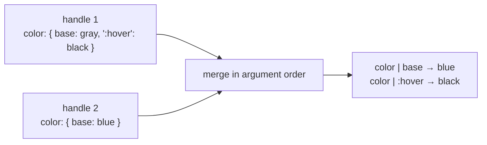

# 08 — Conditions and Cascade

**Owns:** condition kinds and their normal form, merge semantics (`omit` versus `null`), longhand
expansion, value normalization, the precedence ladder, the layer plan, contextual styles,
pseudo-element conditions, relation compilation and validation, and precedence tracing.
**Depends on:** [00-glossary](./00-glossary.md), [20-decisions](./20-decisions.md) (D-011 – D-016, D-036, D-038, D-042, D-045),
[06-authoring-api](./06-authoring-api.md).

This is the most important semantic document in the specification. Every rule here exists because the
opposite behaviour produced a real bug in the StyleX port
(the StyleX comparison).

## Condition kinds

| Kind             | Written as                                                                              | Compiled selector or wrapper                                                        |
| ---------------- | --------------------------------------------------------------------------------------- | ----------------------------------------------------------------------------------- |
| **Pseudo-class** | `":hover"`, `":focus-visible"`, `":nth-child(2n)"`, `":has(> svg)"`, `":not([hidden])"` | `.k…:where(:hover)`                                                                 |
| **Attribute**    | `'[data-state="open"]'`, `'[aria-invalid="true"]'`, `"[data-disabled]"`                 | `.k…:where([data-state="open"])`                                                    |
| **Media**        | `media("(width >= 48rem)")` or the key `"@media (width >= 48rem)"`                      | `@media (width >= 48rem) { … }`                                                     |
| **Container**    | `container("(width >= 28rem)", "card")` or `"@container card (width >= 28rem)"`         | `@container card (width >= 28rem) { … }`                                            |
| **Supports**     | `supports("(display: grid)")` or `"@supports (display: grid)"`                          | `@supports (display: grid) { … }`                                                   |
| **Relation**     | `field.within(":hover")`, `field.after(":checked")`, `field.before()`                   | `.k…:where(.kr…:hover *)`, `.k…:where(.kr…:checked ~ *)`, `.k…:where(:has(~ .kr…))` |

A key may combine selector conditions in one string: `"[aria-haspopup]:active"` is the condition set
`{ [aria-haspopup], :active }`, exactly as if the two were nested (D-038). A key that is not a CSS
property, a recognised condition string, or a condition value is `unknown-condition`.
Nesting conditions means **and**. A condition set is normalized — sorted and deduplicated — so
`{ [md]: { ":hover": v } }` and `{ ":hover": { [md]: v } }` produce the same atom.

**Specificity rule:** every compiled selector is exactly one class plus conditions wrapped in `:where()`,
so all atoms have specificity (0,1,0). Precedence is decided only by the ladder below, never by
selector specificity.

## Merge semantics

Merging happens when `css()`, `cx()`, `sx` arrays or recipe compositions combine styles. Conceptually,
the merged style of one element is a table keyed by **(target, longhand, condition set)**.



**KRN-CAS-004** — Merge rules (D-013):

| Written in a later handle       | Effect on the merged table                                           |
| ------------------------------- | -------------------------------------------------------------------- |
| Property omitted                | Every earlier entry for that longhand is kept.                       |
| `prop: value`                   | Replaces the `base` entry; conditional entries are kept.             |
| `prop: { [condition]: value }`  | Replaces that condition entry; `base` and other conditions are kept. |
| `prop: { base: null }`          | Removes the `base` entry only.                                       |
| `prop: { [condition]: null }`   | Removes that condition entry only.                                   |
| `prop: { "*": null, …entries }` | Removes every entry not listed, then applies the listed entries.     |
| `prop: null`                    | Removes every entry for the longhand.                                |

The merge result is the same whether it is computed at build time or by the private runtime
([09](./09-dynamic-styles.md#private-runtime)).

**INFERENCE:** these rules match what Tailwind authors expect from `text-gray-500 hover:text-black
text-blue-500` and remove StyleX's "a property's conditions must all be declared together" rule.

## Longhand expansion

**KRN-CAS-001** — Merging MUST behave as if every shorthand declaration were expanded into its longhands
(D-011): per longhand, per condition set, in order, with `null` removals. The output packages a shorthand
as **one shorthand atom** where that is exact (D-045):

| Written                               | Compiles to                                          |
| ------------------------------------- | ---------------------------------------------------- |
| `padding: "0"`                        | one `padding` atom covering the four longhands       |
| `paddingInline: space[4]`             | one `padding-inline` atom                            |
| `borderRadius: radius.lg`             | one `border-radius` atom                             |
| `border: "var(--line)"`               | one `border` atom (`unsplittable-shorthand` warning) |
| `inset: offset` (a runtime value)     | one bridged `inset` atom                             |
| `padding: "1px 2px"`                  | `paddingTop` … `paddingLeft` longhands               |
| `border: "1px solid ${theme.border}"` | `borderTopWidth` … `borderLeftColor` (12 longhands)  |
| `flex: 1`                             | `flexGrow: 1`, `flexShrink: 1`, `flexBasis: 0%`      |

Rules:

1. The shorthand/longhand tables come from the engine's property data (generated from MDN's CC0
   `mdn-data`; the licensing notes).
2. Value splitting uses Lightning CSS's typed property parsers.
3. **Box families.** The 31 shorthands whose single component sets every longhand to itself (`padding`,
   `margin`, `inset`, `gap`, `overflow`, `border-radius`, `border-width|style|color`, `place-*`,
   `overscroll-behavior`, `scroll-margin|padding` and their block/inline forms) stay one atom for a
   single component, including a nested `var()` (`calc(var(--x) * 2)`) and a bare `var()` of a project
   token whose declared values are all single components.
4. **Unsplittable values.** A shorthand the typed parsers cannot split — typically a `var()` that may hold
   several components — is one atom too, reported with `unsplittable-shorthand`: if a later style removes
   one of its longhands, the remaining longhands receive the whole value, which is only valid for a
   single component.
5. **Writing over atoms.** A write first unfolds every atom that shares only some of its longhands and is
   no broader than it (a removal: every such atom), narrowest first; then removes the shorthands it fully
   covers; then sets its atom or longhands. Unfolding replaces the atom, in its place in merge order, by the
   longhands it still owns with the atom's value. A longhand entry after the atom keeps its own value; one
   before it is the atom's tombstone or what a broader atom written earlier unfolded into, and is replaced.
6. **Breadth.** An atom ranks at ladder step 5 by its number of longhands; a secondary shorthand (outside
   the families, sharing only some longhands with one, such as `border-top`) ranks one above the largest
   family it overlaps.
7. **Logical and physical.** Logical and physical longhands (`paddingInlineStart`, `paddingLeft`) are
   distinct longhands, and `padding` covers only the physical ones. Which one wins is ladder step 5. Setting
   both on one element produces the `mixed-logical-physical` warning when that outcome can mislead: both set
   the same number of longhands, or the winner was written before the loser (`padding: 0` after
   `paddingInlineStart`). A later, narrower write (`padding` then `paddingInlineEnd`, Tailwind's `p-2 pe-8`)
   wins as written and is not reported. `translate` and `transform` have no logical form: an inline logical
   inset (`insetInlineStart`, `insetInlineEnd`, `insetInline`) beside a translate that moves along x by
   an amount known at build time is the same warning, since with `dir="rtl"` the inset changes side and
   the translate does not (D-098). A translate written per direction (under `:dir()` or `[dir]`) or read
   from a custom property is not reported.

## Value normalization

**KRN-CAS-009** — Before atom identity is computed, values MUST be normalized: whitespace collapsed outside
quoted strings, numbers written as JavaScript prints them, and token references replaced by their
representation ([07](./07-tokens-themes-presets.md#inlined-or-variable)). A longhand keeps the author's
text otherwise; a value produced by splitting a shorthand is printed by the typed parser (`transparent`
may print as `#0000`), and a component the shorthand does not carry is reset with `initial`, as the
shorthand itself resets it. Colours are never converted between colour functions or spaces, and `calc()`
is never simplified. Equal normalized atoms are one rule project-wide.

Values are checked for structure — empty values, unbalanced brackets, `;`, unterminated strings and
`!important` are `invalid-value`.

**KRN-CAS-010** — A value MUST also fit its property's grammar as `mdn-data` writes it
(`kirana_css_data::grammar`), or it is `invalid-value`, naming the syntax it does not fit. The check never
rejects valid CSS, including CSS newer than the data (P11):

- **Not judged, and accepted:** a value with a keyword or function no grammar names, a dimension in a unit
  outside the data, a substitution (`var()`, `env()`, `attr()`) or a bracketed block. It may be newer
  CSS, a name of the author's own, or anything after substitution.
- **Functions by name:** a function is matched by its name alone, never by its arguments, so the hardest
  grammars (`calc()`, colour functions, gradients) cannot reject anything.
- **Undefined types:** a type the data does not define matches any one component.
- **Ranges:** a range on a reference (`<length-percentage [0,∞]>`) holds for the base types it expands
  to, so `padding: -4px` is rejected; a math function is never range-checked.
- **Token domains:** a value that is one project variable token is checked through each value the token
  declares, so a colour token on `padding` is `invalid-value` with no new API. An inlined token is
  checked as the value it inlines.
- **Remembered verdicts:** a verdict depends on the property and the value text alone, so the compiler
  MAY remember it for the session; a token is resolved before the check, so an edited token's new
  value is judged afresh (D-092).

## The precedence ladder

**KRN-CAS-003** — When two atoms for the same target and longhand both match an element, the winner is
decided by this global ladder (D-014). Compare in order; the first difference decides.

| Step | Comparison                                   | Higher wins                                                                                                                                                                                                                                                                         |
| ---- | -------------------------------------------- | ----------------------------------------------------------------------------------------------------------------------------------------------------------------------------------------------------------------------------------------------------------------------------------- |
| 1    | **Origin**                                   | Element's own style beats a contextual style (D-016).                                                                                                                                                                                                                               |
| 2    | **Condition count**                          | More conditions beat fewer (`[md] + :hover` beats `:hover` beats `base`).                                                                                                                                                                                                           |
| 3    | **Strongest condition class**, then the next | `attribute` > `pseudo-class` > `relation` > `at-rule`; a `parent()` read ranks as a pseudo-class (D-104). Compare the sorted classes of both sets from strongest down.                                                                                                              |
| 4    | **Within a class**                           | Pseudo-classes by the table below. At-rules: `@container` > `@media` > `@supports`; width queries by range (larger `min-width` wins; smaller `max-width` wins); non-width media features (`prefers-*`, `print`) above width queries. Attributes and relations: see step 6.          |
| 5    | **Declaration breadth**                      | The narrower declaration wins: a longhand beats a shorthand atom, `borderWidth` beats `border`; breadth is the number of longhands, adjusted for secondary shorthands (D-045); at an equal breadth a physical longhand beats a logical one, and both beat a shorthand atom (D-042). |
| 6    | **Deterministic tie-break**                  | Lexicographic order of the normalized condition text. This step never reflects author intent; reaching it emits `ambiguous-precedence` (below).                                                                                                                                     |

Pseudo-class table (low → high): structural (`:first-child`, `:last-child`, `:only-child`,
`:nth-*`, `:empty`) → `:is`/`:where`/`:not`/`:has` → `:link` → `:visited` → `:target` → `:hover` →
`:focus-within` → `:focus` → `:focus-visible` → `:active` → `:enabled` → `:checked` → `:indeterminate` →
`:placeholder-shown` → `:autofill` → `:required` → `:invalid` → `:disabled`.

**Why this order.** It reproduces what the original Tailwind components of the shadcn/ui port relied on:
state variants beat breakpoints (a `hover:` or `data-[state]:` style wins over `md:` at every width), and
attribute variants beat pseudo-class variants. The port broke exactly these cases under StyleX's
numeric priorities (U4). The ladder is
provisional pending experiment E-03, which checks every condition combination used in the shadcn/ui port
against the Tailwind twin.

**Ambiguity diagnostic.** When one element's merged style holds two entries for the same longhand whose
condition sets tie through step 5, set different values, and can match at the same time (for example
`[data-state="open"]` and `[aria-expanded="true"]`), the compiler emits `ambiguous-precedence` and suggests
nesting one condition inside the other. Two entries with the same value are not ambiguous, since either order
renders the same. Two condition sets cannot match together when, on the element itself or on the same relation
anchor, they test one attribute for different values (`[data-size="sm"]` / `[data-size="lg"]`), test a
selector and its negation (`X` / `:not(X)`), or test different fixed positions counted from the same end
(`:last-child` / `:nth-last-child(2)`). A pair is resolved, and not reported, when the same style holds an
entry whose conditions include both sets: it beats each of them whenever both match, which is exactly what
nesting one condition inside the other writes. Exclusivity a library guarantees but selectors cannot express
(`[data-open]` / `[data-closed]`) is not assumed; the project declares it as `conditions.exclusive`
([11](./11-integrations.md#configuration)). A design system written for several libraries declares one
vocabulary per library as `conditions.exclusiveAcross`: two simple conditions that no vocabulary holds
together, each named by one, are exclusive, since a component is built on one library (D-099).

An entry whose own condition set holds two conditions the compiler knows never match one element
together (two values of one attribute, a selector and its `:not()`, a `conditions.exclusive` group, keys
of two `conditions.exclusiveAcross` vocabularies that no vocabulary holds together) is not emitted (D-105).
The key that made it unreachable is the `unreachable-entry` info, unless only `exclusiveAcross` keeps
the pair apart: that is a style written once for several libraries, and it is left out quietly.

## Layer plan

**KRN-CAS-002** — Every emitted rule MUST be inside a named layer under `kirana` (D-012). The stylesheet
begins with a single order statement:

```css
@layer reset, base, kirana; /* user layers from config: before / after */
@layer kirana.tokens, kirana.themes, kirana.contextual, kirana.atoms;
```

| Layer               | Contains                                                                                                                                    |
| ------------------- | ------------------------------------------------------------------------------------------------------------------------------------------- |
| `kirana.tokens`     | Variable-token declarations on `:root`, with the `@media (prefers-color-scheme: dark)` and mode-marker overrides of non-colour mode tokens. |
| `kirana.themes`     | `defineTheme` overrides, including their per-mode values.                                                                                   |
| `kirana.contextual` | `select.*` styles, written in ladder order.                                                                                                 |
| `kirana.atoms`      | Element-own atoms (including `mode` handles' `color-scheme`), written in ladder order (D-036).                                              |

Every atom selector has specificity (0,1,0), so within a layer the later rule wins and writing atoms in
ladder order is the whole precedence mechanism; no sublayer per ladder bucket is needed.

User layers named in configuration (`layers.before`, `layers.after`) are placed around `kirana` and are
the only place for global element styles such as a reset. Kirana emits no unlayered rules; this includes
custom-property assignments, which StyleX left unlayered (U3).

## Contextual styles

**KRN-CAS-006** — Styles created with `select.descendant()` or `select.child()` compile to
`.k… :where(<target>)` or `.k… > :where(<target>)` in `kirana.contextual`. Because that layer is below
`kirana.atoms`, any style the target element applies to itself wins, whatever its conditions (D-016).
Targets are one compound selector: an optional element name, attribute selectors and pseudo-classes
(`span:last-child`, `a:hover`; D-061) ([06](./06-authoring-api.md#select--contextual-descendant-styles)).

**INFERENCE:** this replaces both StyleX's hand-down custom properties (A8) and Tailwind's
`[&_svg:not([class*='size-'])]` guard: the guard exists only because Tailwind's parent selector would
otherwise win.

## Pseudo-elements

**KRN-CAS-007** — Conditions inside a pseudo-element style apply to the originating element and are
emitted before the pseudo-element: `"::after": { backgroundColor: { ":hover": x } }` compiles to
`.k…:where(:hover)::after`. Attribute, relation and at-rule conditions are supported the same way, so a
position that differs per direction (`[data-swipe-direction="up"]` versus `"down"`) is one style with
per-condition values. Pseudo-element atoms form their own target in the merge table and are ranked by the
same ladder among themselves.

## Relations

### Compilation

A relation named `field` owns one marker class (`.kr…`), applied through `field.anchor`.

| Read                             | Compiles to                       | Meaning                                                      |
| -------------------------------- | --------------------------------- | ------------------------------------------------------------ |
| `field.within()`                 | `.k…:where(.kr… *)`               | Reader is inside an anchor.                                  |
| `field.within(":hover")`         | `.k…:where(.kr…:hover *)`         | Reader is inside a hovered anchor.                           |
| `field.after(":checked")`        | `.k…:where(.kr…:checked ~ *)`     | Reader is a later sibling of a checked anchor.               |
| `field.before()`                 | `.k…:where(:has(~ .kr…))`         | Reader is an earlier sibling of an anchor.                   |
| `field.within(":has(:invalid)")` | `.k…:where(.kr…:has(:invalid) *)` | Reader is inside an anchor that contains an invalid control. |

### Relation validation

**KRN-CAS-005** — The compiler MUST validate relations project-wide (D-015):

| Rule | Condition                                                                                                                                                                                                                                               | Diagnostic                        |
| ---- | ------------------------------------------------------------------------------------------------------------------------------------------------------------------------------------------------------------------------------------------------------- | --------------------------------- |
| R1   | A relation is read but its `anchor` is never referenced anywhere in the project; not for a relation declared `{ optional: true }` (D-112).                                                                                                              | `relation-without-anchor` (error) |
| R2   | An `anchor` is applied but the relation is never read; an exported relation only where the whole project was compiled (D-090).                                                                                                                          | `relation-unused` (warning)       |
| R3   | In one JSX tree, a `within` reader has no anchor among its ancestors (a `parent` reader: on its parent) but an anchor is applied to a sibling or a descendant. A reader that carries the anchor itself reads an outer instance and is accepted (D-101). | `relation-placement` (error)      |
| R4   | In one JSX tree, an `after` reader has no earlier sibling carrying the anchor (a `before` reader: no later sibling) but one is applied elsewhere in that tree.                                                                                          | `relation-placement` (error)      |
| R5   | Two modules of one package declare a relation with the same name, so both share one marker.                                                                                                                                                             | `relation-name-collision` (error) |

In a bundler build, R1 covers the relations whose declaring module the build compiled; one declared in a
module the build never compiled (a shared component reading an ancestor this application does not
render) is left to `kirana-style check`, which compiles every module (D-062).

Any reference to `field.anchor` counts as applying it for R1 and R2 — in an `sx` array, a component prop,
`props()` or a render prop — because anchors routinely travel through components. Placement that crosses
component boundaries cannot always be proven statically. Such reads produce no
diagnostic, and `kirana-style analyze` lists them as "unproven relation reads" so they can be covered by the
conformance suite.

## Precedence tracing

**KRN-CAS-008** — For any element (by source span) and longhand, the compiler MUST be able to explain the
winning value: every matching entry, the ladder step that ordered each pair, and the layer each atom
landed in. This explanation backs `kirana-style trace` and the language server's hover
([12-tooling-and-dx](./12-tooling-and-dx.md)).

```text
$ kirana-style trace src/components/drawer.tsx:88 justifyContent
justifyContent at src/components/drawer.tsx:88
  ✓ center                   @media (width >= 48rem)          kirana.atoms       step 2 (1 condition > 0)
    start                    base                             kirana.atoms
```

On a `recipe()` the explanation names the part each entry comes from (the base, a variant option or a
compound variant, and its slot). Two entries of one slot with the same key are ordered by the recipe's
merge, the later part replacing the earlier, not by the ladder (step 0, `merge`). For tools,
`kirana-style trace --format json` gives each entry as data: value, each condition with its kind
(`pseudo`, `attribute`, `media`, `container`, `supports`, `relation` with the relation's name and
placement), layer, target, class, recipe part, step and reason. Several `file:line property` pairs are
answered in one run, each file compiled once, and `Driver.trace()` answers the same from code
(D-096).
