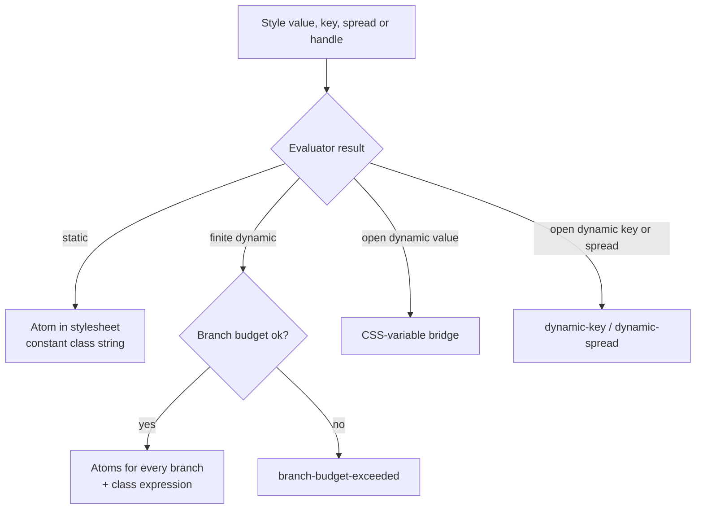

# 09 — Dynamic Styles

**Owns:** how runtime-dependent values compile — the static / finite-dynamic / open-dynamic
classification, class-expression lowering and the branch budget, the CSS-variable bridge, the surface
rules for dynamic input, and the private runtime.
**Depends on:** [00-glossary](./00-glossary.md), [20-decisions](./20-decisions.md) (D-017, D-018, D-037,
D-043),
[06-authoring-api](./06-authoring-api.md), [08-conditions-and-cascade](./08-conditions-and-cascade.md).

## Classification

**KRN-DYN-001** — The restricted evaluator ([10](./10-compiler-architecture.md#restricted-evaluator))
MUST classify every style value, property key, spread and handle argument:

| Class              | Definition                                                 | Example                                                        |
| ------------------ | ---------------------------------------------------------- | -------------------------------------------------------------- |
| **Static**         | Fully resolved at build time.                              | `gap: space[2]`                                                |
| **Finite dynamic** | Chosen at runtime among alternatives that are each static. | `color: isError ? theme.danger : theme.fg`, `cond && styles.x` |
| **Open dynamic**   | Only known at runtime.                                     | `inlineSize: \`${value}%\``, `color: props.color`              |



**KRN-DYN-004** — Whatever the class, Kirana MUST NOT generate, inject or modify CSS rules at runtime
(D-017). Every rule that can apply exists in the build's stylesheet.

## Finite dynamic

**KRN-DYN-002** — Finite-dynamic values MUST compile to class expressions whose every branch is a
precomputed class string:

```tsx
// source
<p sx={css({ color: isError ? "red" : "black", fontWeight: 500 })} />
// output
<p {...__k.sx([isError ? "k50_9ur" : "k50_0yl", "k6y_7Fq"], [], [])} />
```

On a host element the runtime `sx` call also merges the element's `className`, `style` and spreads
(KRN-API-014); a site with nothing to merge at runtime compiles to a plain `className` string.

- Conditional **values** lower per property: independent conditionals concatenate linearly and never
  form a cross product.
- Conditional **objects or handles** (`cond ? a : b`, `cond && b`, `sx={[a, cond && b]}`) lower to one
  branch per alternative, merged with the runtime merger when branches conflict.
- The **branch budget** limits the alternatives one site may expand to; the default is 16 and the
  configuration key is `dynamic.branchBudget` ([11](./11-integrations.md#configuration)). Exceeding it
  is the `branch-budget-exceeded` error, which names the conditionals to split into separate handles.
  There is no runtime fallback, because there is no runtime style engine.

## Open dynamic: the CSS-variable bridge

**KRN-DYN-003** — An open-dynamic value MUST compile to a static atom that reads a custom property, plus
a runtime assignment of that property on the same element:

```tsx
// source
<div sx={css({ inlineSize: { base: `${value}%`, [md]: `${wide}%` } })} />
```

```css
/* stylesheet (one atom per longhand and condition set, shared by every site) */
@layer kirana.atoms {
  .k60_4ko {
    inline-size: var(--k60);
  }
  @media (width >= 48rem) {
    .k60-0w85_zMA {
      inline-size: var(--k60-0w85);
    }
  }
}
```

```tsx
// output
<div
  {...__k.sx(
    [
      __k.b("k60_4ko", "--k60", `${value}%`),
      __k.b("k60-0w85_zMA", "--k60-0w85", `${wide}%`),
    ],
    [],
    []
  )}
/>
// renders className="k60_4ko k60-0w85_zMA" style={{ "--k60": "40%", "--k60-0w85": "80%" }}
```

Rules:

1. The variable name derives from the longhand and condition set only, so the bridge atom is shared by
   every site that bridges the same longhand under the same conditions.
2. The runtime always writes the variable on the element that carries the atom. A `null` or `undefined`
   value is written as `initial`, which makes the declaration invalid at computed-value time so the
   property falls back normally — an ancestor's value can never leak into a descendant.
3. Bridged assignments are merged with any existing `style` prop, Kirana's variables last
   (KRN-API-014).
4. Every bridged site produces the `dynamic-bridged` informational diagnostic, which the language server
   shows inline so authors see which values are runtime-bound ([12](./12-tooling-and-dx.md)).

## Surface rules

| Surface                                     | Finite dynamic                                           | Open dynamic                                                                                                            |
| ------------------------------------------- | -------------------------------------------------------- | ----------------------------------------------------------------------------------------------------------------------- |
| `css()` value at a call site                | Class expression                                         | Bridge                                                                                                                  |
| `css()` property key (`[key]: v`)           | Class expression when the key's alternatives are static  | `dynamic-key` error                                                                                                     |
| Spread into a style object (`...obj`)       | Resolved when the object is finite                       | `dynamic-spread` error                                                                                                  |
| `sx` / `cx()` / `props()` handle arguments  | Class expression, merged at runtime if branches conflict | Handles from props, and spreads of handle arrays (`...variants(options)`), merge at runtime (they are already compiled) |
| `recipe()` variant options                  | Class expression per option                              | Parts merged at runtime (`dynamic-variant` info)                                                                        |
| `defineTokens` / `defineTheme` values       | `dynamic-token` error: tokens are static by definition   | `dynamic-token` error                                                                                                   |
| `relation`, `select`, `keyframes` arguments | Resolved when finite                                     | `dynamic-key` error                                                                                                     |

**KRN-DYN-006** — Every error above MUST carry the source span, the reason, and at least one concrete fix
(for example "move `props.color` into a variant", "declare the property explicitly instead of spreading").

## Private runtime

**KRN-DYN-005** — The private runtime MUST stay at or below **1.0 kB minified and gzipped** in total, and
MUST expose no public API (D-018). The compiler imports it from the subpath `@kirana-style/core/internal` as a
real package export, so every host resolves it without virtual modules. A module creates one instance
for its build's prefix (`const __k = runtime("k")`), which provides:

| Function | Purpose                                                                                                                                                                                                                                                                                                                                                                                                                                                                                                                                                                                                                                                                                                                                                                                   |
| -------- | ----------------------------------------------------------------------------------------------------------------------------------------------------------------------------------------------------------------------------------------------------------------------------------------------------------------------------------------------------------------------------------------------------------------------------------------------------------------------------------------------------------------------------------------------------------------------------------------------------------------------------------------------------------------------------------------------------------------------------------------------------------------------------------------- |
| `cx`     | Merges handles with the semantics of [08](./08-conditions-and-cascade.md#merge-semantics). A handle is a class string, or `{ c, v }` when it carries bridged variables. Every Kirana class name carries its conflict key before the last underscore ([10](./10-compiler-architecture.md#hashing-and-names)), so merging is "last class per key wins" with no per-handle metadata shipped; a `…_` tombstone removes one key and a `…*_` tombstone every key of a property. A box-family atom also removes its longhands, whose codes follow its own, and a `{shorthand}/{codes}…_` token unfolds earlier shorthand atoms into the longhands they still own (D-045). Classes without the build's prefix (from other libraries or another Kirana build) pass through unchanged and in order. |
| `sx`     | The props of a host element or `props()` call: merges the element's own class names first, then the handles; strips tombstones; merges `style` objects with bridged variables last.                                                                                                                                                                                                                                                                                                                                                                                                                                                                                                                                                                                                       |
| `b`      | A bridged handle: an atom class plus its variable assignment, with `null` and `undefined` written as `initial`.                                                                                                                                                                                                                                                                                                                                                                                                                                                                                                                                                                                                                                                                           |
| `recipe` | Resolves a recipe call with runtime options: the base, the chosen option of each variant group and the matching compound entries, merged per slot (D-043).                                                                                                                                                                                                                                                                                                                                                                                                                                                                                                                                                                                                                                |

**INFERENCE:** encoding the conflict key in the class name keeps runtime merging as cheap as a string scan
and makes server and client output identical, which suits server components and streaming SSR
([11](./11-integrations.md#ssr-and-server-components)).
