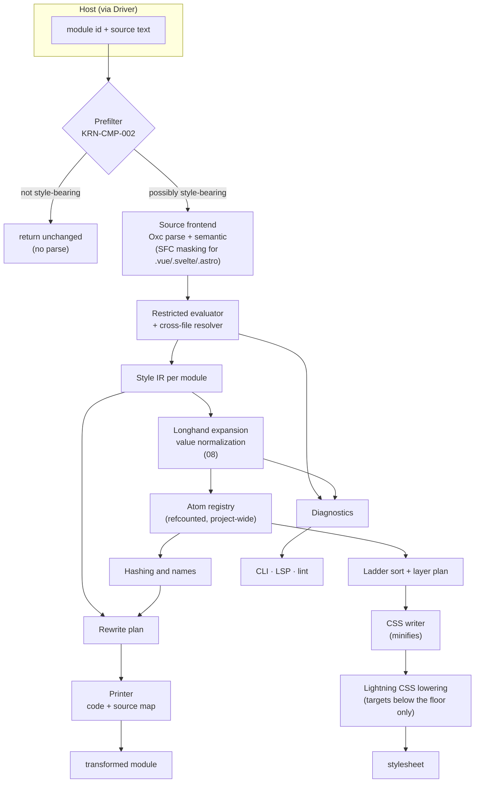
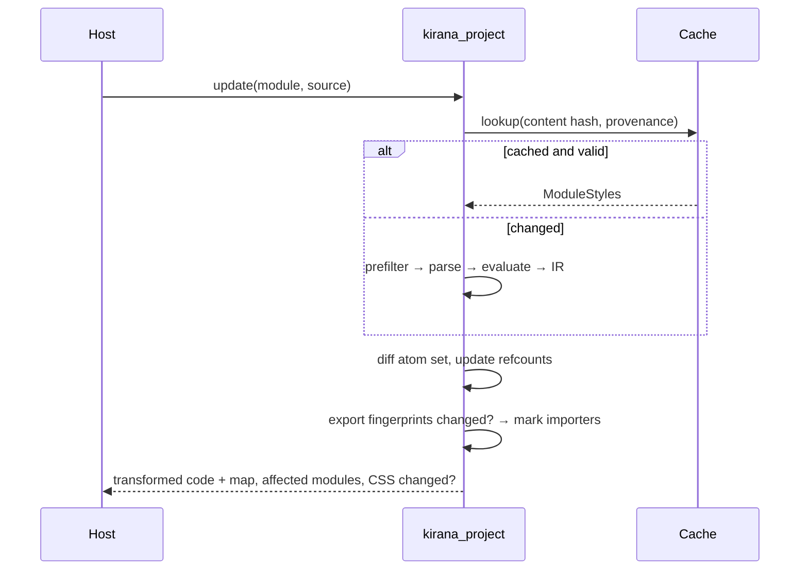

# 10 — Compiler Architecture

**Owns:** the engine's pipeline, crate structure, source frontends, prefilter, restricted evaluator,
cross-file resolution, Style IR, atom registry, hashing and naming, source rewrite, CSS emission,
incremental graphs, parallelism, persistent cache, native and WASM bindings, and the diagnostic
catalogue.
**Depends on:** [00-glossary](./00-glossary.md), [20-decisions](./20-decisions.md) (D-006, D-021 –
D-023, D-037, D-039, D-041, D-044), [08-conditions-and-cascade](./08-conditions-and-cascade.md), [09-dynamic-styles](./09-dynamic-styles.md).

## Pipeline



**KRN-CMP-005** — The Style IR MUST be the only representation that crosses from source frontends to
CSS backends, the rewrite planner, the language server and lint rules. No component re-derives styling
semantics from source text.

## Crates

The workspace follows a one-way tiered dependency model: a crate depends only on crates in lower tiers,
never on a sibling in its own tier unless that exception is documented in its manifest. **INFERENCE:**
this is the same discipline Panda v2 and the StyleX SWC port document, and it keeps the WASM build free
of host-only dependencies.

| Tier | Crate                | Responsibility                                                                                                             |
| ---- | -------------------- | -------------------------------------------------------------------------------------------------------------------------- |
| 0    | `kirana_shared`      | Hashing (XXH3-64), base-62 text, case conversion, the filesystem trait with OS and in-memory implementations.              |
| 0    | `kirana_diagnostics` | Diagnostic type, catalogue, rendering (human, JSON; LSP later), severity overrides.                                        |
| 1    | `kirana_css_data`    | Property index, shorthand and numeric tables, logical/physical pairs, pseudo-class tables — generated from `mdn-data`.     |
| 1    | `kirana_config`      | Resolved configuration schema (serde) and validation.                                                                      |
| 1    | `kirana_ir`          | Style IR: conditions and their normal form, the ladder, handles and merge, names, token/theme/keyframes definitions.       |
| 2    | `kirana_frontend`    | The prefilter; Oxc parsing and semantic analysis; SFC masking adapters later.                                              |
| 2    | `kirana_utility`     | The utility lowering: a utility string to symbolic declarations, shared by the evaluator and the Tailwind codemod (D-058). |
| 2    | `kirana_evaluator`   | Restricted evaluator, pure-function descriptors, the authoring API's semantics.                                            |
| 2    | `kirana_cascade`     | Longhand expansion, value validation and normalization, per-handle property checks (08).                                   |
| 2    | `kirana_emit`        | Layer plan and the CSS writer; Lightning CSS lowering.                                                                     |
| 2    | `kirana_transform`   | Rewrite planning and printing with source maps; relation placement checks.                                                 |
| 3    | `kirana_project`     | Façade: project state, cross-file resolution with provenance, atom registry, project-wide checks, trace, parallel build.   |
| 4    | `kirana_napi`        | Node-API binding (NAPI-RS).                                                                                                |
| 4    | `kirana_migrate`     | The codemods: `migrate stylex` and `migrate tailwind` (KRN-API-013).                                                       |
| 4    | `kirana_cli`         | `kirana-style build`, `check`, `trace` and `migrate`; a library the binding also exposes as `runCli`.                      |

Planned when their milestones need them: `kirana_wasm` (`wasm32-wasip1` and `wasm32-unknown-unknown`) and
`kirana_lsp` (12). The prefilter, token model and resolver each had one caller and under a few hundred
lines, so they live in the crates that use them rather than in crates of their own.

Rules: core crates (tiers 0–3) never depend on Node, a bundler, or an editor protocol. Crates are added
only when a real implementation needs the boundary; no empty placeholder crates.

## Source frontends

**KRN-CMP-001** — JavaScript, TypeScript and JSX MUST be parsed with Oxc (`oxc_parser`, `oxc_ast`,
`oxc_semantic`, arena allocation per module). Vue, Svelte and Astro files MUST be handled by native
adapters that mask markup into position-preserving TypeScript so every span maps back to the original
file; the script parts parse with Oxc. Kirana does not parse or maintain template grammars beyond the
syntax needed to find `sx` bindings and script blocks (D-021).

Semantic analysis is used to resolve bindings, so a local variable that shadows an imported Kirana name
is never treated as a Kirana call.

## Prefilter

**KRN-CMP-002** — Before any parse, each module MUST pass a byte-level prefilter (D-023, D-039): a scan for
`@kirana-style/` or an `sx` attribute (`sx=`, and `sx:` for Vue and Svelte binding forms, not preceded by an
identifier character). No match: the module is returned unchanged with no parse.

A module that only uses imported style values needs no rewrite. Compiled handles, tokens and relations are
ordinary strings and objects at runtime, so such a module runs correctly untouched; inlining them across
modules would be an optimization, never a requirement. Imported modules are still parsed on demand when an
importer that did pass the prefilter needs their exports evaluated (KRN-CMP-004). A false positive costs one
parse; a false negative is impossible because every site that must be rewritten contains `sx` or an import
of `@kirana-style/*`.

**HYPOTHESIS:** on the shadcn/ui port's apps, most modules (dependencies, routes without styles, utilities)
are rejected by stage 1, making transform cost proportional to styled modules. Tested by E-02.

## Restricted evaluator

**KRN-CMP-003** — The evaluator MUST compute style values without executing user code (D-022). It folds:

| Supported                                                                                                                                                     | Not supported (→ dynamic classification or diagnostic)                      |
| ------------------------------------------------------------------------------------------------------------------------------------------------------------- | --------------------------------------------------------------------------- |
| String, number, boolean, `null`, `undefined` literals; template literals                                                                                      | Calls to unknown or impure functions                                        |
| Object and array literals, static spreads, computed keys that fold                                                                                            | `this`, assignments, `delete`, `new`, `await`, generators                   |
| Unary, binary, logical and conditional operators with JavaScript coercion rules; `in` on a folded object or array                                             | Mutable `let`/`var` after reassignment                                      |
| `const` bindings; imports through the cross-file resolver; TypeScript wrappers (`as`, `satisfies`, `!`)                                                       | Globals other than `undefined`, `NaN`, `Infinity`                           |
| Member access on folded objects and arrays; optional chaining                                                                                                 | Dynamic `import()`                                                          |
| TypeScript `enum` members with literal initializers                                                                                                           | Anything exceeding the evaluation depth limit (64) or descriptor size limit |
| Kirana values: tokens, handles, relations, conditions, keyframes, recipes                                                                                     |                                                                             |
| **Pure-function descriptors:** arrow or function declarations with simple parameters and an expression or single `return` body, applied with folded arguments |                                                                             |

A parameter may have a default, evaluated in the function's scope (earlier parameters included) when
its argument is absent or `undefined` (KF-040). A key an object lacks reads as `undefined`, whatever
the object holds; `unknown-token` is reported only for a token group, an object whose every token
sits under its own name (`space[7]` on `space`), at the expression or, inside a descriptor, at the
call (KF-039). A token in `===`, `==`, `!=`, `!==` and `typeof` is the string the compiled code holds
in its place, its CSS text: a variable token never equals a keyword such as `"none"`.

A ternary whose test does not fold but whose branches do yields a finite-dynamic value
([09](./09-dynamic-styles.md#classification)). A position that requires a static value (token definitions,
relation names) and receives a non-foldable expression produces `not-evaluable`.

A string that holds a lone surrogate (`"\uD800"`, which the parser keeps as written) is not folded: no
CSS value, key, class or module specifier can carry one. As a value it produces `not-evaluable`; an
import or re-export from such a specifier is a runtime value; an `enum` member named by one is left
out, its numbering kept.

## Cross-file resolution

**KRN-CMP-004** — Imports MUST be resolved with `oxc_resolver` (relative paths, extension probing,
`tsconfig` paths, `package.json` `exports` and conditions) and followed through named, namespace,
default and re-export forms and barrels (D-006). Each resolved module keeps an export entry cache:

```text
module path → (content hash,
               export name → folded value | pure-function descriptor | Kirana value,
               provenance: [(dependency path, content hash seen)])
```

Installed packages (resolved paths inside `node_modules`) are evaluated the same way only when they are
Kirana packages — named `@kirana-style/*` or declaring `@kirana-style/core` in `dependencies` or `peerDependencies` — so a
preset or design system from npm folds exactly as its workspace copy does, while icon sets and utility
libraries are never parsed. Any other installed module is a runtime value. An import that does not resolve
at all makes every value depending on it a runtime value and produces the `unresolved-import` warning, once
per import per module, at the first use: that is almost always missing dependencies or an alias the
engine's resolver does not know.

An entry is reused only when its content hash and every provenance hash still match. Descriptors are
lowered while the module's AST is alive and stored as owned data, so cached modules do not pin arenas.
Cycles are detected with an in-progress marker and reported as `not-evaluable`.

## Style IR

```rust
/// One module's styling facts.
pub struct ModuleStyles {
    pub module: ModuleId,
    pub definitions: Vec<Definition>,      // tokens, themes, relations, keyframes, recipes, handles
    pub sites: Vec<Site>,                  // sx attributes, css()/cx()/recipe calls to rewrite
    pub exports: Vec<(ExportName, ValueRef)>,
    pub diagnostics: Vec<Diagnostic>,
}

/// An atom is the unit of CSS output and of runtime merging.
pub struct Atom {
    pub target: Target,                    // Element | PseudoElement(PseudoId) | Contextual(Selector)
    pub property: PropertyId,              // always a longhand (08), or a flagged unsplittable shorthand
    pub value: AtomValue,                  // Normalized CSS | TokenRef | BridgeVar | KeyframesRef
    pub conditions: ConditionSet,          // sorted, deduplicated SmallVec<Condition>
    pub origin: Origin,                    // Own | Contextual
}

pub enum Condition {
    PseudoClass(PseudoId, Option<Box<str>>),
    Attribute(Box<str>),
    Media(MediaQuery),
    Container(Option<Box<str>>, ContainerQuery),
    Supports(Box<str>),
    Relation { relation: RelationId, kind: RelationKind, state: Option<Box<[Condition]>> },
}
```

Conflict key of an atom = `(target, property, conditions)`; value identity = `value`. Both feed the
names below. Recipes are stored as per-option handles plus compound entries, so static calls resolve to
atom sets and runtime calls merge the chosen parts (D-043, [09](./09-dynamic-styles.md#private-runtime)).

## Atom registry

`kirana_project` keeps one registry for the whole project:

- a map from atom to reference count and name;
- per module, the set of atoms it contributes.

Replacing a module's styles decrements its old atoms and increments its new ones; atoms reaching zero
leave the stylesheet. Reads (emit, hover, analyze) borrow the registry without copying.

## Hashing and names

**KRN-CMP-006** — Names MUST be deterministic, path-independent and fixed-width (D-037). With the default
prefix `k`, development and production use the same names:

| Output             | Name                                                                                                    | Example        |
| ------------------ | ------------------------------------------------------------------------------------------------------- | -------------- |
| Atom class         | `k` + property code + `-` target (3, if not the element) + `-` conditions (4, if any) + `_` + value (3) | `k50-KFHz_0yl` |
| Entry tombstone    | the atom class without its value: removes one entry in a runtime merge                                  | `k50-KFHz_`    |
| Property tombstone | `k` + property code + target + `*_`: removes every entry of the property                                | `k50*_`        |
| Unfold             | `k` + shorthand code + `/` + kept longhand codes joined by `.` + target + `-` conditions or `*` + `_`   | `k0/1.2.3*_`   |
| Bridged variable   | `--k` + conflict-key segment                                                                            | `--k50-KFHz`   |
| Variable token     | `--kv` + hash (5) of package, namespace and key                                                         | `--kvHHzaz`    |
| Relation marker    | `kr` + hash (5) of package and relation name                                                            | `krAbc12`      |
| Theme              | `kt` + hash (5) of package and overrides                                                                | `ktJrGI3`      |
| Keyframes          | `kf` + hash (5) of package and frames                                                                   | `kfPvE9N`      |
| Mode marker        | `km-` + mode                                                                                            | `km-dark`      |

- The property code is the base-62 index of the property in the table generated from `mdn-data`. The
  31 box families come first — each shorthand followed by its longhands, four-longhand families in
  blocks of five, then two-longhand families in blocks of three — so a family atom's code locates its
  longhands (D-045) and the most used properties take one character (`padding` is `0`). Every other
  property follows in name order. A custom property's code is a 5-character hash.
- Other segments are base-62 text of XXH3-64 hashes over normalized parts: the target text, the condition
  set's canonical text, and the value (with the longhand count when a shorthand set more than one, so
  atoms that rank differently never share a name). Inputs include the owning package name for
  definitions, never a file path.
- Widths never change. The registry checks every class and conflict-key segment after each update; two
  different atoms with one name is the `class-name-collision` error: the build is not trusted and the
  case is reported upstream. Lengthening on collision would make a name depend on which modules compiled
  first.
- Tombstones and unfold tokens travel inside class strings so a later runtime merge can apply removals
  and shorthand atoms exactly; the host element's `class` attribute never receives them.
- Readable names come from `kirana-style trace` and the language server, not from a second naming scheme.
- **Dense names (D-084).** A production build with `names: "dense"` renames the condition and value
  segments of every name the compiler wrote, and of the stylesheet. They become codes of 1–2
  characters, assigned from the whole build in order of use and kept for the session. The property
  code and the target stay, so merging is unchanged. Transforms write a `^~` mark before each name, so
  only those are renamed; renaming runs in the host's `renderChunk`.

## Source rewrite

**KRN-CMP-007** — For a style-bearing module the engine MUST return rewritten code with a source map; for
every other module it MUST return "unchanged" so the host keeps the original bytes and map. The rewrite:

1. replaces static `css()`, `cx()`, recipe and `sx` sites with class strings, class expressions, and
   bridged `style` objects ([09](./09-dynamic-styles.md));
2. replaces definitions (`defineTokens`, `relation`, `keyframes`, `recipe`) with the minimal runtime
   values their remaining consumers need (class strings, variable references, recipe tables). Every
   runtime call it writes is marked `/* @__PURE__ */`, so a bundler drops a table or a runtime instance
   whose consumers all resolved at build time;
3. removes Kirana authoring imports whose uses were all erased, and adds `@kirana-style/core/internal`
   imports only for runtime functions the module still uses;
4. applies all edits in one pass with span-based string editing (`string_wizard`, from the Rolldown
   ecosystem) and emits a source map (`oxc_sourcemap`) whose `sources` entry is the module id the host
   passed in, so bundlers and coverage tools resolve it to the same file;
5. reports `sx-on-external-component` for `sx` on a component imported from an installed package, which
   does not know the prop (D-041), and for `sx` on a project component that spreads its rest props, `sx`
   included, onto such a component or a host element. The imported module's analysis is part of its
   cached exports (`Exports::sx_forwarding`), so the check costs one lookup per call site.

## CSS emission

The CSS writer (D-036, D-044):

1. collects live atoms from the registry and splits contextual from own atoms
   ([08](./08-conditions-and-cascade.md#the-precedence-ladder));
2. writes the layer order statement, the token and theme layers, the contextual layer, then the single
   `kirana.atoms` layer with atoms sorted by the ladder and its deterministic tie-break;
3. wraps condition selectors in `:where()` and at-rules around rules, so every atom selector has
   specificity (0,1,0) and source order is ladder order;
4. prints minified CSS itself in production ([13](./13-output-and-performance.md)); development output is
   indented with the same order;
5. passes the stylesheet through Lightning CSS only when configured targets are below the default floor,
   for lowering. Lightning CSS's minifier is not used: it resolves `color-mix()` and rewrites colours even
   at the floor targets.

## Incremental graphs

**KRN-CMP-008** — The project MUST maintain these graphs so that work after an edit is proportional to the
edit:

| Graph          | Nodes                             | Invalidates                                          |
| -------------- | --------------------------------- | ---------------------------------------------------- |
| Module graph   | modules, content hashes           | re-extraction of the edited module                   |
| Export graph   | exported values with fingerprints | importers only when an export's fingerprint changed  |
| Token graph    | tokens, aliases, themes           | atoms whose values reference a changed token         |
| Atom registry  | atoms and per-module sets         | stylesheet regions whose atoms were added or removed |
| Relation index | anchors and reads                 | relation validation for the affected relations       |



The host re-requests affected modules through its normal transform path; the engine never calls back into
host code.

## Parallelism and cache

**KRN-CMP-009** — Prefiltering, parsing, evaluation and IR construction for independent modules MUST run
in parallel (candidate: `rayon`); registry updates apply in a single ordered step so results do not depend
on thread scheduling.

**In a bundler host.** A bundler calls `transform` once per module. Vite runs those hooks
concurrently, and a synchronous call compiled them one after another on its thread. The Vite and
Rolldown hosts' builds call `transformAsync`, which compiles on the Node.js worker pool instead,
while the dev server keeps one transform at a time. The registry is shared and the stylesheet is
written in path order, so the output is byte-identical either way. The WASI engine compiles on the
calling thread.

**KRN-CMP-010** — A persistent cache (default `node_modules/.cache/kirana`) MUST store per-module
extraction results keyed by compiler version, configuration hash, module content hash and provenance
hashes, in a compact binary encoding. Deleting the cache MUST only cost time, never change output.

**Deferred (D-049).** The engine is 0.05 s of a 16.2 s build of the three applications, so a cache
that skips that work saves nothing measurable, while every key it has to get right is a way to serve
stale CSS. The in-memory incremental graph, which is what the dev server uses, is unaffected.

**Within one build (D-085).** A one-shot build reuses a module's transform when its source and every
file its evaluation read are unchanged, so the SSR build does not compile again what the client build
compiled. It is in memory, for that build only, and off in a dev server, a watch build and the
language server.

## Configuration boundary

**KRN-CMP-013** — The engine MUST receive configuration as resolved, serializable data. Loading
`kirana.config.ts`, applying presets and resolving host options happen in the Driver
([11](./11-integrations.md#configuration)); the engine never evaluates configuration code.

## Bindings

- **Native:** `kirana_napi` exposes a long-lived `Compiler` session: `new Compiler(config)`,
  `transform(id, code)` (code and map, or unchanged; diagnostics; dependencies; whether the stylesheet changed),
  `stylesheet(minify)`, `diagnostics()`, `invalidate(id)` (the affected importers), `remove(id)`, and `runCli(argv)`; `inspect(id,
  span)` arrives with the language server. Each transform crosses the boundary once with compact results —
  never serialized ASTs.
- **KRN-CMP-012 — WASM:** the same crates MUST build for `wasm32-wasip1` (a fallback package for
  environments where native addons cannot load, such as WebContainers) and `wasm32-unknown-unknown`
  (the browser playground), using the in-memory filesystem.

## Diagnostics

**KRN-CMP-011** — Every diagnostic MUST have a stable code, a name, a severity, a primary span, an
explanation, and optional fixes, and MUST render identically in the CLI (human and JSON), the language
server (LSP `Diagnostic`), lint rules, and CI annotations. A diagnostic's code and name never change
meaning once released.

```text
error[KRN1403] relation-placement
  --> src/components/field.tsx:42:18
   |
42 |       <label sx={label}>
   |                  ^^^^^ reads field.within(…) but the anchor is on this element's sibling
   |
help: move `field.anchor` to the element that wraps both, or use `field.after(…)`
```

### Diagnostic catalogue

| Code    | Name                            | Severity | Owner doc |
| ------- | ------------------------------- | -------- | --------- |
| KRN1001 | `parse-error`                   | error    | 10        |
| KRN1101 | `not-evaluable`                 | error    | 10        |
| KRN1102 | `unsupported-syntax`            | error    | 10        |
| KRN1103 | `unresolved-import`             | warning  | 10        |
| KRN1201 | `unknown-property`              | error    | 06        |
| KRN1202 | `invalid-value`                 | error    | 06        |
| KRN1203 | `unitless-length`               | error    | 06        |
| KRN1204 | `unsplittable-shorthand`        | warning  | 08        |
| KRN1205 | `mixed-logical-physical`        | warning  | 08        |
| KRN1206 | `invalid-fallback`              | error    | 06        |
| KRN1207 | `fallback-on-variable`          | warning  | 06        |
| KRN1208 | `invalid-position-try`          | error    | 06        |
| KRN1209 | `invalid-view-transition`       | error    | 06        |
| KRN1210 | `invalid-counter-style`         | error    | 06        |
| KRN1301 | `unknown-condition`             | error    | 08        |
| KRN1302 | `ambiguous-precedence`          | warning  | 08        |
| KRN1303 | `unsupported-contextual-target` | error    | 06        |
| KRN1304 | `select-state-on-parent`        | info     | 06        |
| KRN1305 | `unreachable-entry`             | info     | 08        |
| KRN1401 | `relation-without-anchor`       | error    | 08        |
| KRN1402 | `relation-unused`               | warning  | 08        |
| KRN1403 | `relation-placement`            | error    | 08        |
| KRN1404 | `relation-name-collision`       | error    | 08        |
| KRN1501 | `unknown-token`                 | error    | 07        |
| KRN1502 | `token-namespace-collision`     | error    | 07        |
| KRN1503 | `variable-default-scope`        | warning  | 07        |
| KRN1504 | `dynamic-token`                 | error    | 09        |
| KRN1505 | `unsupported-dtcg-type`         | error    | 07        |
| KRN1506 | `token-not-variable`            | error    | 07        |
| KRN1507 | `token-namespace-shared`        | info     | 07        |
| KRN1601 | `dynamic-bridged`               | info     | 09        |
| KRN1602 | `branch-budget-exceeded`        | error    | 09        |
| KRN1603 | `dynamic-key`                   | error    | 09        |
| KRN1604 | `dynamic-spread`                | error    | 09        |
| KRN1605 | `dynamic-variant`               | info     | 09        |
| KRN1701 | `unused-sx`                     | warning  | 06        |
| KRN1702 | `utility-surface-disabled`      | error    | 06        |
| KRN1703 | `sx-on-external-component`      | warning  | 06        |
| KRN1704 | `unknown-utility`               | error    | 06        |
| KRN1705 | `unknown-utility-variant`       | error    | 06        |
| KRN1706 | `utility-not-static`            | error    | 06        |
| KRN1707 | `utility-unsupported`           | error    | 06        |
| KRN1801 | `unknown-variant`               | error    | 06        |
| KRN1802 | `unknown-slot`                  | error    | 06        |
| KRN1901 | `invalid-config`                | error    | 11        |
| KRN1902 | `target-lowering`               | info     | 13        |
| KRN1903 | `class-name-collision`          | error    | 10        |
| KRN1904 | `classes-not-static`            | error    | 11        |
| KRN1905 | `unknown-class-name`            | error    | 12        |
