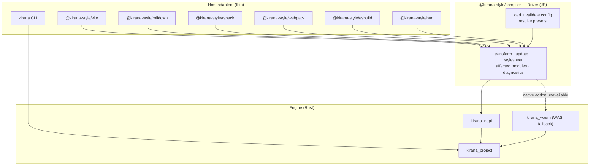
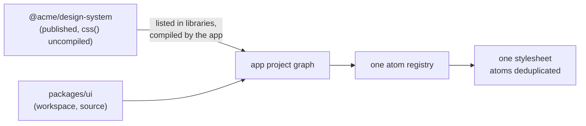

# 11 — Integrations

**Owns:** the Driver and host-adapter contract, the configuration file, the stylesheet entry, the bundler
and framework matrices, SSR and server components, runtimes, package managers and native distribution,
monorepos and published libraries, and HMR.
**Depends on:** [00-glossary](./00-glossary.md), [20-decisions](./20-decisions.md) (D-028, D-029, D-037, D-050, D-051, D-052),
[10-compiler-architecture](./10-compiler-architecture.md).

## Layering



**KRN-INT-001** — The Driver MUST own configuration loading, preset resolution, the compiler session,
change batching and affected-module tracking. A host adapter MUST only:

1. select which module ids reach the Driver (the prefilter still runs in the engine);
2. forward `transform(id, code)` results (code, source map, dependencies) to the host;
3. serve the stylesheet entry (below) in development and emit it in production;
4. register reported dependencies and file changes with the host's watcher;
5. map host lifecycle hooks (build start/end, HMR) to Driver calls.

An adapter MUST NOT interpret styles, decide rewrites, or merge classes (D-028).

## Configuration

`kirana.config.ts` (or `.mts`, `.js`, `.mjs`, `.json`) at the project root. The Driver loads it — a
TypeScript config is imported natively (Node.js type stripping, Bun, Deno) once per session — and hands
the engine resolved data (KRN-CMP-013). Options passed to a host adapter override the file key by key.
A `.ts` configuration, and each `.ts` file it imports, loads as an ES module when it holds `import` or
`export` statements, even in a package whose `"type"` is `"commonjs"` (which `npm init` writes), where
Node.js alone would read it as CommonJS and fail.

```ts
import { defineConfig } from "@kirana-style/core/config"
import scales from "@kirana-style/preset-scales"

export default defineConfig({
  presets: [scales()],
  layers: { before: ["reset", "base"] }, // user layers placed before `kirana`
  targets: { chrome: 123, safari: "17.5", firefox: 120 }, // default shown (13)
  jsx: "react", // "react" | "preact" | "solid": which attribute sx compiles to
  dynamic: { branchBudget: 16 }, // (09)
  names: { prefix: "k" }, // 1–4 lowercase letters (10)
  libraries: ["@acme/design-system"], // published Kirana libraries to consume by manifest
  diagnostics: { "relation-unused": "off" }, // warnings and infos only
  conditions: { exclusive: [["[data-starting-style]", "[data-ending-style]"]] }, // (08)
})
```

| Key           | Default                                                  | Notes                                                                                                                                                                                                                                                                                                                                                  |
| ------------- | -------------------------------------------------------- | ------------------------------------------------------------------------------------------------------------------------------------------------------------------------------------------------------------------------------------------------------------------------------------------------------------------------------------------------------ |
| `presets`     | `[]`                                                     | Composition rules in [07](./07-tokens-themes-presets.md#presets).                                                                                                                                                                                                                                                                                      |
| `layers`      | `{ before: [], after: [] }`                              | Layer plan in [08](./08-conditions-and-cascade.md#layer-plan).                                                                                                                                                                                                                                                                                         |
| `targets`     | floor from D-026                                         | Output rules in [13](./13-output-and-performance.md).                                                                                                                                                                                                                                                                                                  |
| `jsx`         | detected from `tsconfig` `jsxImportSource`, else `react` | Controls `className` versus `class`.                                                                                                                                                                                                                                                                                                                   |
| `dynamic`     | `{ branchBudget: 16 }`                                   | [09](./09-dynamic-styles.md#finite-dynamic).                                                                                                                                                                                                                                                                                                           |
| `names`       | `{ prefix: "k" }`                                        | A different prefix lets two independently built Kirana apps share one page. Names never differ between development and production (D-037).                                                                                                                                                                                                             |
| `libraries`   | `[]`                                                     | See [published libraries](#monorepos-and-published-libraries).                                                                                                                                                                                                                                                                                         |
| `ui`          | none                                                     | The component registry's settings, read by `kirana-style ui` (`@kirana-style/registry`), never by the engine; the Driver leaves it out of what it passes (KRN-DX-020, D-103).                                                                                                                                                                          |
| `diagnostics` | all at catalogue severity                                | Only warnings and infos may be re-levelled; errors cannot be disabled because they mean output would be wrong.                                                                                                                                                                                                                                         |
| `conditions`  | `{ exclusive: [] }`                                      | Groups of single attribute or pseudo-class conditions a library never sets together; `ambiguous-precedence` treats them as exclusive (08). A design system exports its groups for apps to spread into their configuration. `exclusiveAcross` takes one vocabulary per library, `ownAttributes` the attributes the project's own components write (08). |
| `classes`     | none                                                     | The class map for server templates (D-069): `{ modules, out }`; `kirana-style build` and `kirana-style dev` write every exported handle's class string to `out`.                                                                                                                                                                                       |
| `externals`   | `[]`                                                     | Specifier prefixes a bundler provides (`@ember/`, `meteor/`): imports from them are runtime values without `unresolved-import` (D-072).                                                                                                                                                                                                                |

Invalid configuration is the `invalid-config` diagnostic with the offending key path.

## Stylesheet entry

An application imports the stylesheet once, at its entry:

```ts
import "@kirana-style/core/stylesheet.css"
```

`@kirana-style/core` ships the file for real, holding one placeholder rule, so the specifier resolves in every
pipeline — as a side-effect import, a `?url` import for a `<link>`, or without an adapter. Host adapters
serve its content: in development the live stylesheet, updated through CSS HMR; in production the
placeholder rule, which the adapter replaces with the finished stylesheet once every module has compiled,
renaming the asset by its content hash and patching every chunk and asset that names it (including
`index.html` and server chunks). The CLI writes the stylesheet to a chosen path (`kirana-style build --out`).
Development and production share layer order and precedence (D-037, KRN-OUT-007 in
[13](./13-output-and-performance.md)).

**Modules re-emitted under a query.** A host may serve a variant of a module under a query string —
TanStack Start's route splitting serves `route.tsx?tsr-split=component`, and bundlers use `?worker` and
similar. The adapter MUST compile those variants: it matches the extension before the query and strips
the query for the module's identity, excluding only the asset queries `?raw`, `?url` and `?inline`. A
filter anchored on the extension alone hands the browser the uncompiled source of that chunk, where
`css()` then throws at runtime.

## Bundlers and build tools

**KRN-INT-002** — Vite and Rolldown MUST be supported first (P0), including Vite's dev server, HMR, SSR
builds and library mode.

**KRN-INT-003** — Other hosts follow this matrix:

| Host                                            | Priority | Mechanism                                                                                                   | Status                                                                                                                                                                                                                                                                            |
| ----------------------------------------------- | -------- | ----------------------------------------------------------------------------------------------------------- | --------------------------------------------------------------------------------------------------------------------------------------------------------------------------------------------------------------------------------------------------------------------------------- |
| Vite 8                                          | P0       | `@kirana-style/vite`: the Rolldown plugin plus the dev server (live stylesheet, CSS HMR)                    | Built. Covers Vitest, Astro, SvelteKit (`examples/sveltekit`), Nuxt (`examples/nuxt`), React Router on Vite, and, each with an example, TanStack Start, SolidStart, Vike, Waku (under `vite.plugins`), VitePress 2 (with `cssLayer` for its theme) and Storybook's Vite builders. |
| Rolldown                                        | P0       | `@kirana-style/rolldown`; emits the stylesheet as an asset (`kirana.css`)                                   | Built (`examples/rolldown-react`).                                                                                                                                                                                                                                                |
| Rspack / Rsbuild                                | P1       | `@kirana-style/rspack`: the webpack plugin, which Rspack runs unchanged; `pluginKirana`                     | Built (`examples/rsbuild-react`). Covers TanStack Start on Rsbuild.                                                                                                                                                                                                               |
| webpack 5                                       | P1       | `@kirana-style/webpack`: `pre` loader + plugin filling the CSS asset                                        | Built (`examples/webpack-react`); Next.js with webpack through `withKirana` from `@kirana-style/webpack/next` (`examples/next-webpack`).                                                                                                                                          |
| Bun bundler                                     | P1       | `@kirana-style/bun`: `onLoad` + `onEnd` rewriting the emitted CSS                                           | Built (`examples/bun-react`).                                                                                                                                                                                                                                                     |
| esbuild                                         | P2       | `@kirana-style/esbuild`: `onLoad` + `onEnd` filling the bundled CSS                                         | Built (`examples/esbuild-react`); watch and serve reload the stylesheet from a live file.                                                                                                                                                                                         |
| Next.js with Turbopack                          | P1       | `@kirana-style/next`: a loader in `turbopack.rules`; `@kirana-style/postcss` fills `@kirana;` (KRN-INT-010) | Built (`examples/next-turbopack`); the same `withKirana` configures `next build --webpack` too.                                                                                                                                                                                   |
| Angular CLI                                     | P2       | `@kirana-style/angular:application`, `:dev-server`: Angular's builders given a compiled mirror (D-068)      | Built (`examples/angular-cli`); Analog runs on the Vite adapter (`examples/analog-angular`).                                                                                                                                                                                      |
| React Router, Gatsby, Meteor, Docusaurus        | P2       | `className` + `style` object                                                                                | Vite; webpack through `@kirana-style/gatsby` (D-071); Rspack (D-073); Docusaurus through a local plugin's `configureWebpack`, its aliases as `externals`. Built                                                                                                                   |
| Remix 3                                         | P2       | `className` in compiled JSX calls (`jsx("p", { sx })`)                                                      | `@kirana-style/remix`: a Node `load` hook after `node-tsx`, `kiranaLoader` for the asset server, the stylesheet as middleware. Built (`remix`)                                                                                                                                    |
| Ember (`.gjs`, `.gts`)                          | P2       | Handles in scope, merged by the `sx` helper                                                                 | The Vite adapter after Embroider (D-072). Built (`ember`)                                                                                                                                                                                                                         |
| Server templates (Blade, Twig, ERB, HEEx, Edge) | P2       | A class map and a helper per language (D-069)                                                               | `kirana-style build`/`dev` with `classes`. Built (`laravel`, `symfony`, `rails`, `phoenix`, `adonisjs`)                                                                                                                                                                           |
| Parcel                                          | P2       | `@kirana-style/parcel-transformer` for scripts; `@kirana-style/postcss` fills `@kirana;` (D-070)            | Built (`examples/parcel`).                                                                                                                                                                                                                                                        |
| Jest                                            | P2       | `@kirana-style/jest`: a transformer that compiles, then hands off to `babel-jest` (or another)              | Built (`examples/jest-react`). Vitest is covered by the Vite plugin.                                                                                                                                                                                                              |
| CLI (no bundler)                                | P0       | `kirana-style build`, `kirana-style dev`                                                                    | Both built (`kirana-style dev` watches and rewrites the stylesheet). Plain HTML, web components, server templates.                                                                                                                                                                |

**How each host ends up with the stylesheet** (D-052). Vite bundles CSS, so the entry is the
placeholder stylesheet Vite processes and the adapter fills in and renames. Rolldown alone does not,
so its adapter emits the stylesheet itself. webpack and Rspack treat the entry as ordinary CSS; the
plugin fills the emitted asset at `processAssets`' optimize stage, before the CSS minimizer and
before `realContentHash` renames it by content. Bun's adapter rewrites the emitted CSS in `onEnd`.
Turbopack runs loaders but no plugins, so its stylesheet comes from PostCSS: `@kirana-style/postcss` compiles
the project in the stylesheet that holds `@kirana;`, in a session of its own (KRN-INT-010).
Every compiler of one project — Next.js's server, edge and client — shares one Driver, which is how
atoms from server components reach the client's stylesheet.

**Development servers.** Every host updates the stylesheet in development. webpack, Rspack (and
Rsbuild, Next.js), Bun and esbuild follow a live file outside `node_modules` that the adapter rewrites
whenever the stylesheet changes, so the bundler rebuilds the entry and delivers it its own way (CSS hot
update, or esbuild's live reload). Vite's sends CSS hot updates (KRN-INT-009) to every dev server the plugin
serves — Nuxt runs one for the client and one for the server — under the URL the client's module graph
knows the stylesheet by (`/node_modules/…` when it is inside the project root, `/@fs/…` outside it),
and answers `?inline` with the live stylesheet, which SvelteKit's server render inlines. A change that
finds the stylesheet's own transform still running (Vite pre-transforms an entry's imports, so the page's
first component can compile after the stylesheet was read) invalidates the module as an edit would, so
Vite discards that stale result rather than caching it, and sends the update again once Vite has
analysed the module. CI starts the
dev server of every Vite-based example and requires a style edit to reach the page, in place without
a reload where the framework updates components that way (Vue, Nuxt, Svelte, SvelteKit). (The watch-build-only
limitation recorded earlier is resolved.)

Each built host has an example under `packages/kirana/examples/` that CI installs from the packed
tarballs, builds and checks in Chromium (the compatibility matrix).

## Frameworks

**KRN-INT-004** — `sx` compiles per framework without a framework-specific engine:

| Framework / source                       | Priority | `sx` compiles to                                     | Source handling                                                                                         |
| ---------------------------------------- | -------- | ---------------------------------------------------- | ------------------------------------------------------------------------------------------------------- |
| React (and React Native Web DOM targets) | P0       | `className` + `style` object                         | TSX/JSX via Oxc                                                                                         |
| Preact                                   | P1       | `class` + `style` object                             | TSX/JSX via Oxc. Built (`vite-preact`)                                                                  |
| Solid                                    | P1       | `class` + `style` object                             | TSX/JSX via Oxc. Built (`vite-solid`)                                                                   |
| Vue (SFC)                                | P1       | `:class` + `:style` bindings                         | SFC masking adapter Built (`vite-vue`)                                                                  |
| Svelte                                   | P1       | `class=` + `style:` directives                       | SFC masking adapter Built (`vite-svelte`)                                                               |
| Astro                                    | P1       | `class` + `style` attributes                         | SFC masking adapter Built (`astro`)                                                                     |
| Vanilla / web components                 | P1       | Handles are class strings: `el.className = cx(a, b)` | Plain TS/JS. Built (`vite-vanilla`)                                                                     |
| Qwik 2                                   | P2       | `class` + `style` object                             | TSX via Oxc. Built (`qwik`, D-067)                                                                      |
| Angular                                  | P2       | `[sx]` directive, merged by the runtime (D-068)      | Angular's emitted JS (Analog) or a mirror of the sources (CLI). Built (`analog-angular`, `angular-cli`) |

The `jsx` key selects the attribute (`className` for React, `class` for Preact, Solid and Qwik); left
out, the Driver reads `compilerOptions.jsxImportSource` from the project's `tsconfig.json` (`preact`,
`solid-js`, `@qwik.dev/core`, `@builder.io/qwik`) and otherwise uses React. Under a `class` mode a `className` already on the element is
merged into the one `class` the element gets, since Preact users still write it. The private runtime
is created with the attribute (`runtime(prefix, attribute)`), so dynamic `sx` and `props()` return
the same key the static path writes; passing it from the compiler rather than defaulting it in the
runtime keeps the runtime at 997 bytes gzip, 2 fewer than before the modes existed (KRN-DYN-005).
`@kirana-style/core/preact`, `@kirana-style/core/solid` and `@kirana-style/core/qwik` add `sx` to each framework's JSX
types, as `@kirana-style/core/react` does for React.

On a Vue component, a caller's `:sx` compiles to the `class` Vue falls through to the root, which Vue
concatenates with the root's own. `useSx()` from `@kirana-style/core/vue` returns the caller's classes and
the other fallthrough attributes, for a component that turns `inheritAttrs` off and writes
`:sx="[own, sx]"` on its root, so Kirana's runtime merges the caller's styles last (the adapter folds the root's own
`v-bind` object into the compiled binding with Vue's `mergeProps`, since an element takes one); a Svelte component
takes its `class` prop the same way, with no helper (D-100). The adapter compiles components in `load`
and names each one to the watcher, as Vite does for a file outside the root it reads itself, so a
component from a workspace package hot-reloads (D-100).

**Qwik** (D-067) is a JSX mode on Vite 8, so Qwik 2: Qwik 1 supports Vite 7 and older. The optimizer
splits each `$` function into a module of its own after Kirana has compiled the file, and the handles
are module constants those modules import. Qwik adds its client stylesheet to the bundle after
Kirana's `generateBundle` (`order: "pre"`) has run, so the Vite adapter returns a second plugin,
`kirana:late` (`enforce: "post"`, `generateBundle` `order: "post"`), which fills any stylesheet asset
still holding the placeholder; on every other host it finds nothing to do.

**Angular** (D-068, `design-notes/angular.md`). A template reaches only its component's members, so
`sx` there cannot be compiled away: `@kirana-style/angular` exports `SxDirective` (selector `[sx]`, input
`Sx`), which merges the handles with the private runtime through `Renderer2` and adds and removes
only the classes and properties it set. The compiler still compiles every `css({...})` in the
component's TypeScript, so the stylesheet and the class names are the ones a JSX app gets; only the
merge moves to the browser. Angular compiles TypeScript from its own program on disk, so nothing can
transform a source before it:

- **Analog** (Vite): `kiranaAngular()` from `@kirana-style/angular/vite` is the Vite adapter with
  `enforce: "post"`, compiling the JavaScript Angular emitted for each module.
- **Angular CLI**: the builders `@kirana-style/angular:application` and `:dev-server` wrap `@angular/build`'s.
  They mirror the source root into `.kirana/` (style-bearing modules compiled, every other file
  copied, so relative imports and `templateUrl`s resolve inside the mirror), pass every TypeScript file
  except the entries as `fileReplacements`, and add `.kirana/kirana.css` to `styles`. In watch mode
  each change is mirrored again with the modules that read from it. The builders' schemas are copies
  of `@angular/build`'s, kept equal as JSON by a test, because Architect resolves a schema only inside the
  builder's package.

**Components** (D-053, `design-notes/sfc-masking.md`). Vue, Svelte and Astro components are
compiled by the Vite adapter's `load` hook, before any framework plugin: each script block (`<script>`,
`<script setup>`, Svelte's instance and module scripts, Astro's frontmatter) compiles as its own module
(`Card.vue.setup.ts`), and each `sx` binding becomes a spread of the runtime's `sx()` with the
`class` attribute — Vue `:sx` → `v-bind`, Svelte and Astro `sx={…}` → `{...…}` with the element's own
`class` and `style` folded in. The framework's parser (`vue/compiler-sfc`, `svelte/compiler`,
`@astrojs/compiler-rs` or `@astrojs/compiler`) is loaded from the application. `@kirana-style/astro` is the
Astro integration: it adds the adapter, and after the build renames the stylesheet — which Astro
inlines or links by a name recorded early — by its content. `@kirana-style/core/vue`, `/svelte` and `/astro`
type `sx` in templates.

## SSR and server components

**KRN-INT-005** — Compiled output MUST work unchanged in server rendering, streaming, and React Server
Components: class strings and compiled recipe tables are plain values, the private runtime is pure and
side-effect free, and the stylesheet is a normal asset, so no style collection or injection step exists
on the server or the client.

## Runtimes

**KRN-INT-006** — The Driver and adapters MUST run on Node.js active LTS releases, Bun, and Deno (through
npm specifiers and Node-API). When the native addon cannot load, the Driver MUST fall back to the WASI
build automatically and report which engine is in use in `kirana-style doctor`.

Deno runs the Driver and adapters through its Node compatibility and the native addon through
Node-API; CI builds examples with Deno as the runtime. (Deno as the installer waits for the registry:
`deno install` links a local tarball as a directory.)

The WASI build (D-055) is `@kirana-style/compiler-wasm32-wasi`, loaded after the native package and the
workspace's native build: when neither is installed, when one is installed but fails to load (with a
warning naming its error), or when `KIRANA_FORCE_WASI=1`. `Driver.engine` reports `"native"` or
`"wasi"`, which `kirana-style doctor` prints. Its output is byte-identical to the native
engine's; CI forces it for a full example build and compares the two stylesheets.

## Package managers and distribution

**KRN-INT-007** — Installation MUST work with npm, pnpm (including strict `node_modules`), Yarn (including
Plug'n'Play) and Bun (D-029):

- `@kirana-style/compiler` lists per-platform packages as `optionalDependencies`; the package manager installs
  only the matching one. Targets: `darwin-arm64`, `darwin-x64`, `linux-x64-gnu`, `linux-x64-musl`,
  `linux-arm64-gnu`, `linux-arm64-musl`, `win32-x64-msvc`, `win32-arm64-msvc`, plus
  `@kirana-style/compiler-wasm32-wasi` as the fallback.
- No Kirana package runs `preinstall`, `install` or `postinstall` scripts, so no allow-list
  (`trustedDependencies`, `onlyBuiltDependencies`) is required.
- All packages are ESM with type declarations; the CLI is also published as standalone binaries for CI
  environments without Node.
- The Driver loads `@kirana-style/compiler-<triple>` first. Only when that package is not installed does it
  look for `kirana.<triple>.node` beside itself (the workspace, where the engine is built in place);
  a package that is installed but fails to load is an error, never a reason to try another binary.
  `KIRANA_NATIVE_PATH` names a binary explicitly. Linux gnu binaries link against glibc 2.17 (D-050).
- Packages are compiled at pack time, one ESM file and declaration per source file (D-050).

**Installation is tested, not assumed** (E-08, D-051). `bun run kirana:pack` writes every package and
platform package as the tarball it would be published as; `bun run kirana:example <example> --pm <pm>`
copies an example out of the repository, points its `@kirana-style/*` dependencies at those tarballs through
the package manager's own overrides (npm and Bun `overrides`, pnpm's workspace `overrides`, Yarn
`resolutions`), installs, builds, checks the stylesheet and reads a probe's computed style back in
Chromium. CI runs it for npm, pnpm, Yarn (node_modules and Plug'n'Play) and Bun on Linux x64 and
arm64, macOS arm64 and Windows x64, and for npm, pnpm and Bun on Alpine (musl); pull requests run a
Linux subset. **FACT:** Yarn resolves every optional platform package to write its lockfile, including
the ones it will not install, so all eight must exist wherever Yarn installs from (a registry, or the
tarball set); npm, pnpm and Bun skip the ones that do not match.

## Component libraries

**KRN-INT-011** — A headless component library's part states MUST be available as typed condition keys
(D-088). `@kirana-style/states` ships one vocabulary per library, generated from the library's published
declarations and checked against its exports:

| Subpath           | Library                                 | Source                                                                                                                                                                                                                                                          |
| ----------------- | --------------------------------------- | --------------------------------------------------------------------------------------------------------------------------------------------------------------------------------------------------------------------------------------------------------------- |
| `./base-ui`       | Base UI (`@base-ui/react`)              | each part's `*DataAttributes` module, named by `index.parts`                                                                                                                                                                                                    |
| `./ark-ui`        | Ark UI, on React, Vue, Solid and Svelte | `@zag-js/docs` at the Zag version Ark UI depends on, kept to what `@ark-ui/react` exports; an attribute its reference describes in prose whose values a Zag type fixes (`data-orientation`, `Orientation` in `@zag-js/types`) takes that type's values (KF-041) |
| `./react-aria`    | React Aria Components                   | each `<Name>RenderProps` interface's `@selector`, inheritance resolved, kept to exported components                                                                                                                                                             |
| `./reka-ui`       | Reka UI (Vue)                           | each exported part's template in the shipped `src/`, through the library components it renders its element with; values from the literals the bindings or their helpers return                                                                                  |
| `./bits-ui`       | Bits UI (Svelte)                        | each exported part's state class, by the literal types of its `props`; a part's own name attribute left out                                                                                                                                                     |
| `./ng-primitives` | Angular Primitives                      | each `createPrimitive` block's `dataBinding` calls and `ngpInteractions` flags, kept to blocks with a directive (D-102)                                                                                                                                         |

A vocabulary is plain data (an `as const` object of attribute selectors), so a library without one, or a
project's own components, needs a module of a few lines and nothing from the compiler.

Each vocabulary also exports `exclusive`, the states its library sets one at a time on a part (a state
and its documented opposite, both presences), for `conditions.exclusive` in `kirana.config`: the
project opts in, and the compiler needs nothing new. `exclusiveAcross(...vocabularies)`, from the package's
root, returns each vocabulary's state selectors for `conditions.exclusiveAcross`, for a design system that
writes one look for several libraries (D-099).

## Monorepos and published libraries

**KRN-INT-008** — Styles MUST compile exactly once per application, whether they come from the application,
a workspace package, or a published library, and duplicate atoms MUST be emitted once.

- **Workspace packages** are compiled from source as part of the application's project graph; workspace
  resolution follows `package.json` workspaces and `tsconfig` paths.
- **Published libraries** ship their `css()` calls uncompiled and no CSS of their own (D-054). An
  application lists them in `libraries`; every adapter then compiles those packages' modules from
  `node_modules` as it compiles the application's own, so their atoms land in the application's single
  stylesheet deduplicated with its own, under its prefix, targets and layers, and their tokens and
  relations resolve through the same evaluator. The Vite adapter keeps listed libraries out of
  dependency pre-bundling in every environment that pre-bundles (the client's, and a server
  environment that discovers dependencies, such as Cloudflare's Worker in workerd) and out of SSR
  externals, and names the runtime (`@kirana-style/core/internal`), which compiled output imports
  and no source names, for pre-bundling wherever Vite discovers dependencies, so the first request
  does not re-optimise. A library that is not listed throws at its first `css()`
  with a message naming `libraries`. Libraries apply styles with `props()` or `cx`, which compile in
  plain JavaScript; `sx` needs JSX. (`kirana-style build --library` and `kirana.manifest.json`, specified
  before, are withdrawn: `packages/kirana/design-notes/published-libraries.md`.)
- **Kirana's own style packages** (`@kirana-style/preset-scales`, `KIRANA_LIBRARIES` in the compiler's
  `host.ts`) are compiled as listed libraries without being listed, wherever the project installs them:
  the evaluator already folds their values as Kirana's (KRN-TOK-008), and a module of theirs the
  application imports at runtime must not reach the browser with its `defineTokens()` calls
  uncompiled. A test fails when a Kirana package declares tokens or styles at the top level and is
  missing from the list.



## Hot module replacement

**KRN-INT-009** — In development, editing a module MUST update the stylesheet through the host's CSS HMR
without a full reload when only styles changed, with the registry's exact atom set (removed atoms leave the
stylesheet) and the production layer order. Editing a module that exports tokens or relations MUST re-run
only the affected importers reported by the engine
([10](./10-compiler-architecture.md#incremental-graphs)).

**KRN-INT-010** — A host that runs loaders but no plugins (Next.js with Turbopack) MUST get the same
stylesheet as every other host: a loader rewrites each module's styles, and a PostCSS plugin replaces
the `@kirana;` directive (or the stylesheet entry's placeholder rule) with the stylesheet of the whole
project, compiled incrementally by modification time. The two sessions agree on class names because
names never depend on build order (D-037). The plugin MUST return `dir-dependency` messages for the
project and its compiled libraries, and a `dependency` on the configuration file, so a dev server runs
it again on a change (D-065, `design-notes/turbopack.md`).
