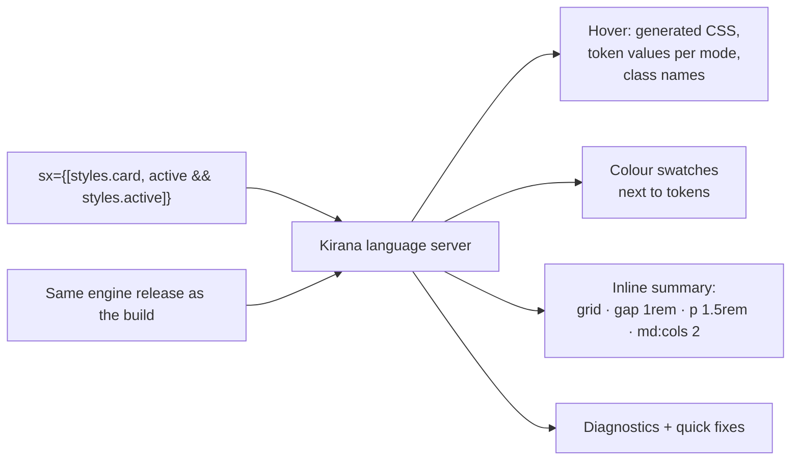

# 12 — Tooling and Developer Experience

**Owns:** the language server and editor features, the CLI, lint rules, formatter compatibility, editor
latency budgets, and the browser devtools direction.
**Depends on:** [00-glossary](./00-glossary.md), [20-decisions](./20-decisions.md) (D-003, D-030, D-031),
[08-conditions-and-cascade](./08-conditions-and-cascade.md), [10-compiler-architecture](./10-compiler-architecture.md).

## The readability promise

> **Readable at the source, optimized at runtime.**

Tailwind's strongest DX property is that styles are readable where they are used: the class list is in the
tag, colours are visible, and hover shows the CSS. Object styles move that information into a definition
elsewhere. Kirana brings it back through tooling instead of through verbose class names in the DOM, which
would cost deduplication and bytes.

## Language server

**KRN-DX-001** — Editor features MUST be provided by `kirana_lsp`, a Rust language server speaking LSP
over stdio, built on the same `kirana_project` crate as the build (D-030). It runs next to the
TypeScript language server and only answers styling questions; it never duplicates type completions
TypeScript already provides.

| Editor                    | Delivery                                                                                   |
| ------------------------- | ------------------------------------------------------------------------------------------ |
| VS Code, Cursor, Windsurf | Thin extension that downloads or locates the `kirana` binary and starts `kirana-style lsp` |
| Zed                       | Extension registering the language server                                                  |
| Neovim, Helix             | Documented `lspconfig` / language configuration                                            |
| JetBrains IDEs            | LSP client plugin                                                                          |

Built (sprint 6): VS Code and Zed extensions under `packages/kirana/editors/`, both starting the
project's own `node_modules/.bin/kirana-style lsp` (D-064; Zed finds it through the root `package.json`,
since it does not index `node_modules`); Neovim and Helix configurations are documented.
The server answers for TypeScript and JavaScript; Vue, Svelte and Astro components compile through the
Driver's masking, which it does not run yet.

Server behaviour: discovers `kirana.config.*` per workspace folder, keeps an in-memory project updated
from open-document changes plus file-watch events, and publishes the same diagnostics as `kirana-style check`
([10](./10-compiler-architecture.md#diagnostics)).

### Features

| Requirement    | Feature           | LSP surface                                                       | Behaviour                                                                                                                                                                                                                                                                                                                                                                                                                                                                                                                                                                                                                                                               |
| -------------- | ----------------- | ----------------------------------------------------------------- | ----------------------------------------------------------------------------------------------------------------------------------------------------------------------------------------------------------------------------------------------------------------------------------------------------------------------------------------------------------------------------------------------------------------------------------------------------------------------------------------------------------------------------------------------------------------------------------------------------------------------------------------------------------------------- |
| **KRN-DX-002** | Hover             | `textDocument/hover`                                              | On a style handle, `sx` value, recipe call, token, relation or condition: the generated CSS grouped by condition, resolved token values for both modes, class names, bridged variables, and a one-line precedence note linking to `kirana-style trace`.                                                                                                                                                                                                                                                                                                                                                                                                                 |
| **KRN-DX-003** | Colour decorators | `textDocument/documentColor`, `colorPresentation`                 | Swatches next to colour tokens and colour literals; a `light-dark()` literal gets one per mode. Mode tokens show the light value with both values on hover. The colour picker edits literals only, never token references, and offers the format the colour is written in first.                                                                                                                                                                                                                                                                                                                                                                                        |
| **KRN-DX-004** | Style summary     | `textDocument/inlayHint`, `textDocument/codeLens`                 | After `sx={…}`, a compact summary of what the element receives (`grid · gap 1rem · p 1.5rem · md: cols 2`), written with a preset's vocabulary when one maps the values, otherwise short CSS. On `css()` and `recipe()` definitions, a code lens with declaration, condition and bridged-value counts. Both are configurable.                                                                                                                                                                                                                                                                                                                                           |
| **KRN-DX-005** | Completion        | `textDocument/completion`                                         | Where TypeScript cannot complete: CSS keyword values, condition strings (`":focus-visible"`, attribute selectors), `select.*` targets, and — at M5 — utility strings. Token and variant keys are completed by TypeScript through inferred types (D-007).                                                                                                                                                                                                                                                                                                                                                                                                                |
| **KRN-DX-006** | Navigation        | `references`, `definition`, `workspace/symbol`                    | Find every use of a token, recipe variant, relation or atom; jump from a relation read to where its anchor is applied; workspace symbols for tokens, recipes, relations and keyframes.                                                                                                                                                                                                                                                                                                                                                                                                                                                                                  |
| **KRN-DX-007** | Code actions      | `textDocument/codeAction`, `workspace/executeCommand`             | Quick fixes attached to diagnostics; "Extract to `css()`"; "Inline style handle"; "Vary at md" and "Vary on :hover" on a plain value; "Convert Tailwind classes to `css()`" on a selection (the migration engine); "Show compiled CSS"; "Explain precedence" (trace).                                                                                                                                                                                                                                                                                                                                                                                                   |
| **KRN-DX-013** | Style card        | `textDocument/hover`, `inlayHint/resolve`                         | On an element's `sx`, a `css()` or a recipe: the expression and the handles it merges (with their `sx` guards and links to their definitions); the box model drawn as DevTools draws it (an SVG `data:` image in the client's theme when the client sends `images` and `theme`, a text drawing otherwise); the resolved properties by group in source order with pixel equivalents, tokens and colour swatches; the values under conditions, targets and guards; what is overridden; the compiled CSS. The inline summary's tooltip is the same card, resolved lazily. A value is attributed to the handle the `sx` names, in the same file first (`Project::origins`). |
| **KRN-DX-014** | Structure         | `documentSymbol`, `documentHighlight`, `foldingRange`, `codeLens` | The outline lists styles, recipes, tokens and relations; a key highlights the elements in the file that receive it and an element the keys it receives; style objects fold with their summary as the folded text; a "used by N elements" lens opens the elements across the project whose `sx` names the definition and receives most of its classes. Each inline summary carries its parts and their groups, so a client can colour it as the card colours properties.                                                                                                                                                                                                 |
| **KRN-DX-015** | Client views      | `kirana/inspect`, `kirana/styleRanges`, `kirana/stats`            | Requests for a client's own views: the resolved style at a position and the entries that hold under a given set of conditions and guards (simulated from each atom's ladder rank, `SiteAtom.rank`); each style object's range and summary; the stylesheet's size. VS Code builds the Style Inspector, Style Fold and its status bar on them.                                                                                                                                                                                                                                                                                                                            |
| **KRN-DX-016** | Components        | every feature                                                     | Vue, Svelte and Astro: script blocks compile under the build's module ids (`Card.vue.setup.ts`); the template's `sx` bindings are appended to the block the template sees as JSX, so each is a site; every span maps back into the component. A scanner (`kirana_frontend::sfc`) finds blocks and bindings; `sfc-scan.test.ts` holds it to the frameworks' parsers.                                                                                                                                                                                                                                                                                                     |

**KRN-DX-011 — Latency budgets (met, E-06):** on our shadcn/ui port, hover p95 ≤ 50 ms,
diagnostics refreshed ≤ 200 ms after an edit, and server memory ≤ 300 MB after indexing all three apps.
Measured by `bench/lsp.ts` in the benchmark repository (2026-10-02): hover p95 1.2 ms, diagnostics p95 7.1 ms,
65 MB.

## CLI

**KRN-DX-008** — The `kirana` binary MUST provide:

| Command                                                                                        | Purpose                                                                                                                                                                                                                                                                                                                                                                                   |
| ---------------------------------------------------------------------------------------------- | ----------------------------------------------------------------------------------------------------------------------------------------------------------------------------------------------------------------------------------------------------------------------------------------------------------------------------------------------------------------------------------------- |
| `kirana-style init [--yes] [--dry-run] [--install] [--preset]`                                 | Detect framework, bundler and package manager (npm, pnpm, Yarn, Bun, Deno); create `kirana.config`; wire the host adapter (Next.js with Turbopack: `withKirana`, the PostCSS plugin, `@kirana;`), the stylesheet and the `sx` types; show every edit as a diff and write on a yes; print the install command (D-066). Built.                                                              |
| `kirana-style build [--out] [--library]`                                                       | Compile without a bundler, or build a publishable library with its manifest ([11](./11-integrations.md#monorepos-and-published-libraries)). With `classes`, also writes the class map for server templates (D-069).                                                                                                                                                                       |
| `kirana-style dev [paths] [--out] [--minify]`                                                  | Watch mode for bundler-less projects: recompile what changed and what read from it, rewrite the stylesheet when it changed; with `classes`, rewrite the class map and watch its modules too. Built.                                                                                                                                                                                       |
| `kirana-style check [paths] [--config file] [--format human\|json\|github] [--max-warnings n]` | Diagnostics only, for CI; exit code reflects errors, and warnings over `--max-warnings`. `github` prints workflow commands that annotate the changed lines (D-081). Built.                                                                                                                                                                                                                |
| `kirana-style analyze [paths] [--json\|--html <file>]`                                         | Atoms and reuse, CSS bytes by layer and by module (exclusive bytes too), bridged sites, runtime recipes, themes and the tokens they override, unproven relation reads, the project's tokens never read. Built.                                                                                                                                                                            |
| `kirana-style export [paths] [--out file] [--definitions]`                                     | The design system as JSON (KRN-DX-017). Built.                                                                                                                                                                                                                                                                                                                                            |
| `kirana-style trace <file:line> <property>… [--format json]`                                   | Explain the winning value for a property on an element ([08](./08-conditions-and-cascade.md#precedence-tracing)).                                                                                                                                                                                                                                                                         |
| `kirana-style doctor [--json] [--report [file]] [--trace]`                                     | Engine in use (native or WASI), installed versions, configuration resolution, detected host and whether the adapter, stylesheet and types are wired, cache state (none, D-049). Exit 1 on a failure. `--report` writes a redacted bug report: versions, checks, diagnostics by code, stylesheet size, configuration, optional `kirana-style trace` output; no source text (D-077). Built. |
| `kirana-style migrate stylex\|tailwind`                                                        | The codemods of [06](./06-authoring-api.md#migration-codemods), with a dry-run diff and a report file.                                                                                                                                                                                                                                                                                    |
| `kirana-style lsp`                                                                             | Start the language server.                                                                                                                                                                                                                                                                                                                                                                |

There is no `kirana cache clean`: Kirana keeps no persistent cache (D-049), so there is nothing to
clear, and `kirana-style doctor` says so.

**KRN-DX-019** — `check`, `trace` and `export` MUST read, for each path, the nearest `kirana.config.*` above
it, or the working directory's when there is none, and `--config <file>` MUST make every path read that
file (D-097). Paths sharing a configuration run together; the human output names the configuration of
each group when it is not the working directory's or there are several, and `--format json` stays one
array. `export` reads one configuration and asks for `--config` when its paths read several. A
configuration that fails to load is reported as the file and the module it could not find, with exit
code 2; a relative import without its extension is called out, since Node.js loads the configuration
without a bundler.

## Lint

**KRN-DX-009** — Lint rules MUST ship as `@kirana-style/eslint-plugin`, an ESLint-compatible plugin that Oxlint
loads through `jsPlugins` and ESLint loads through flat config (D-031):

- Rules read the Driver's inspection API; they never re-implement validation. The package pins the exact
  `@kirana-style/compiler` version it was released with.
- The project is inspected once per lint run, then rule visitors only look up results.
- **FACT:** Oxlint's JavaScript plugin support is documented as alpha
  ([Oxlint JS plugins](https://oxc.rs/docs/guide/usage/linter/js-plugins.html)); the plugin also works
  under ESLint so teams are not blocked on it.

| Rule                               | Config      | What it does                                                                                                                                                                        |
| ---------------------------------- | ----------- | ----------------------------------------------------------------------------------------------------------------------------------------------------------------------------------- |
| `kirana/diagnostics`               | recommended | Reports every compiler diagnostic at its span (warnings and errors by default), so a lint-only CI still sees them.                                                                  |
| `kirana/sx-last`                   | recommended | A forwarded `sx` should be the last entry of an `sx` array or `props()` call so callers can override; other handed-down values may follow. Autofix.                                 |
| `kirana/no-conflicting-props`      | recommended | `className` or `style` next to a `{...props()}` spread on one element: JSX keeps one of them.                                                                                       |
| `kirana/override-keeps-conditions` | recommended | A plain `sx` value for a property the component sets under a structural condition, which keeps winning there. Suggestions: the same condition, or `{ "*": null, base }`.            |
| `kirana/no-classname-on-sx`        | recommended | `className` given to a project component that reads `sx` and does not spread its props.                                                                                             |
| `kirana/no-unused`                 | recommended | A module-local style handle or recipe option nothing applies. Not in Vue, Svelte or Astro files, whose templates the linter does not see.                                           |
| `kirana/no-dark-variant`           | recommended | A `prefers-color-scheme` condition in a style, or a Tailwind `dark:` class in a class or `sx` string: dark mode the page's chosen mode never reaches.                               |
| `kirana/sort-properties`           | strict      | Canonical property order (layout → box → typography → visual → other → custom properties → blocks); conditional values `base`, then ladder step 3's classes weakest first. Autofix. |
| `kirana/prefer-token`              | strict      | A literal equal to a token's value suggests the token, with its import.                                                                                                             |
| `kirana/finite-bridge`             | strict      | A bridged value only ever called with a few literals in its file suggests variants instead.                                                                                         |
| `kirana/no-class-helpers`          | strict      | An import of `clsx`, `classnames`, `tailwind-merge` or `class-variance-authority`: joined class strings do not merge.                                                               |
| `kirana/restricted-properties`     | off         | A property, or a literal value of one, the project's options rule out (`{ float: { reason }, display: { values } }`). Matched as written; tokens pass.                              |
| `kirana/use-logical-properties`    | off         | A side or corner of the inline axis written physically (`marginLeft`); suggests the logical property (`marginInlineStart`). Never an autofix (D-093).                               |

The candidate rules were decided at M3 (D-063): unused handles and variants are `no-unused`, a
`className` reaching an `sx` component is `no-classname-on-sx`; restricted overrides are a type-level
feature, not a rule, and the contextual-rule report stays in the codemod. The project root is the
nearest `kirana.config.*` above the linted file, or `settings.kirana.root`. Results are identical under
Oxlint and ESLint, reports and fixes alike (`npm/eslint-plugin/test/parity.test.ts`). The two rules
marked `off` encode a project's own policy and are in neither preset (D-093).

**Biome.** `@kirana-style/biome-plugin` MUST carry, as Biome GritQL plugins, the rules that need no compiler:
`sx-last`, `no-conflicting-props`, `no-dark-variant`, `no-class-helpers` and `use-logical-properties`, with
`recommended` and `strict` presets that mirror the ESLint configs (D-079); `use-logical-properties` is in
neither, as in ESLint. A GritQL plugin matches syntax only — it cannot read the
Driver or another file — so the compiler-backed rules reach a Biome project through `kirana-style check --format
github --max-warnings 0` in CI and the language server in the editor. The plugins report what their ESLint
originals report, line, column and message (`npm/biome-plugin/test/biome.test.ts`); they match the
documented local names (`styleProps`, `css`, `recipe`, `media`) rather than resolving imports. The sx-last
reorder is an ESLint autofix only. **FACT:** Biome's GritQL grammar may change between releases
([Biome GritQL](https://biomejs.dev/reference/gritql/)); the tests pin the version.

## Design system export

**KRN-DX-017** — `kirana-style export [paths] [--out file]` MUST print the project's design system as JSON
(D-080): `schema` (1), the engine version and class prefix; every token with its identity, value, both
halves of a `light-dark()` pair or a per-mode value, whether it is a variable, and `file:line`; each
exported theme with its class and the tokens it overrides; each exported recipe with its slots, variant
groups and options in declaration order, defaults and compound count; every relation with the files that
declare, anchor and read it; and the exported keyframes, `positionTry` and `viewTransition` names. Origins
are project-relative; no source text is included; every list is sorted. The exit code follows `check`.
Each token also names its package, so two packages' groups of one name stay apart (the
`token-namespace-shared` info points such a pair out).

With `--definitions` it MUST also give what each exported `css()` handle (and each one inside an exported
object) and each part of each exported recipe evaluates to (D-096): its entries in merge order, each with
its property, value (`null` for a removal), conditions by kind, target, the variable tokens it reads and
the token it assigns by identity, the keyframes it names and its class; and the relations it anchors.
`Driver.export()` returns the same JSON from code.

## Agent skills

**KRN-DX-018** — The repository MUST ship agent skills in `skills/` at its root, in the format the
`skills` CLI installs (`npx skills add`): `kirana` (writing and fixing styles) and `kirana-migrate`
(from Tailwind or StyleX) (D-078). Each `SKILL.md` keeps the rules and the workflow — `kirana-style export`,
`check`, lint, `trace`, `doctor --report` — and puts detail in `references/`. The diagnostics and lint
references are generated from the compiler's source by `apps/docs/scripts/generate-skills.ts`, which
fails on a diagnostic without a stated fix and on a broken reference or docs link; CI runs it with
`--check`.

## Formatter

**KRN-DX-010** — Kirana MUST NOT ship a formatter. Source is formatted by Oxfmt or Prettier; rewritten
output is formatted by whatever the host does with transformed modules. Property ordering is a lint
autofix (`kirana/sort-properties`). The conformance suite includes a check that Oxfmt and Prettier output
of Kirana fixtures compiles to identical CSS.

## Browser devtools (later)

**KRN-DX-012** — After 1.0, a browser extension MAY map class names back to source spans using development
names and a build-time name map, showing for a selected element its atoms, their layer and ladder bucket,
and the source that produced each. It is not part of the feasibility phase.
