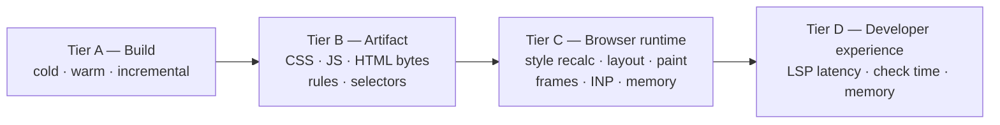

# 14 — Benchmark Methodology

**Owns:** how Kirana is measured — benchmark tiers, corpora, targets compared, fairness rules,
statistics, the result schema, the claims policy, and the reproduction of the existing baseline.
**Depends on:** [00-glossary](./00-glossary.md), [20-decisions](./20-decisions.md) (D-032),
the measured baseline, [13-output-and-performance](./13-output-and-performance.md),
[15-testing-and-conformance](./15-testing-and-conformance.md).

## Why a methodology first

The baseline in the measured baseline is useful but single-sample and not
fully controlled. Public styling benchmarks are mostly vendor-run on vendor templates, small, and
unmaintained. Kirana's credibility depends on numbers anyone can reproduce, including the ones that do not
favour Kirana.

## Tiers

**KRN-BENCH-001** — Every benchmark belongs to exactly one tier:



| Tier             | Metrics                                                                                                                                                                                                                    |
| ---------------- | -------------------------------------------------------------------------------------------------------------------------------------------------------------------------------------------------------------------------- |
| **A — Build**    | Wall time; CPU user + system; peak RSS; transform calls; modules parsed by the styling tool; for incremental: time from file write to stylesheet available.                                                                |
| **B — Artifact** | CSS raw / gzip / brotli (all minified); rule, selector and declaration counts; unique declarations; bytes per layer; JS raw / gzip; styling runtime bytes; rendered HTML bytes; total `class` and `style` attribute bytes. |
| **C — Runtime**  | First render (FCP, LCP); total "Recalculate Style", "Layout" and "Paint" time from Chrome performance traces; long tasks; INP for scripted interactions; p95 frame time while scrolling; JS heap; DOM node count.          |
| **D — DX**       | Language-server hover and diagnostics latency (p50, p95); server memory after indexing; `kirana check` wall time.                                                                                                          |

## Corpora

**KRN-BENCH-002** — Benchmarks run on these corpora, versioned in `bench/corpora/` in the benchmark repository:

| Corpus          | Description                                                                                                                                                                                                                                                        | Tiers   |
| --------------- | ------------------------------------------------------------------------------------------------------------------------------------------------------------------------------------------------------------------------------------------------------------------ | ------- |
| **three-way**   | The shadcn/ui port's `apps/web`, `apps/blocks` and `apps/examples` in three structurally identical implementations: the Tailwind original, the StyleX port, and the Kirana port (`kirana` branch, complete since sprint 2).                                        | A, B, C |
| **scale-curve** | A seeded generator producing equivalent component sources for each target at 100, 1,000 and 10,000 components, with a fixed distribution of conditions, tokens, recipes, relations and dynamic values. It reports curves, never a single point.                    | A, B    |
| **large-dom**   | An ERP-style table page with 1,000, 5,000, 10,000 and 25,000 rows; each row has a status badge, text cells, a select, an icon button and a conditionally rendered button. Scripted interactions: scroll through, filter (full re-render), hover sweep across rows. | B, C    |
| **edit-trace**  | A recorded sequence of edits on the three-way corpus: change a value, add a condition, change a token, add a styled file, delete a styled file.                                                                                                                    | A, D    |
| **editor**      | A replay of language-server requests (hover, diagnostics, completion) recorded while editing the three-way corpus.                                                                                                                                                 | D       |

Generated corpora are deterministic (fixed seed, no clock or randomness at run time) and byte-identical for
every target.

## Targets compared

| Target                      | Tiers      | Why it is in the matrix                                                   |
| --------------------------- | ---------- | ------------------------------------------------------------------------- |
| Kirana                      | A, B, C, D | Subject.                                                                  |
| StyleX (official, unplugin) | A, B, C    | The system Kirana is closest to in output model; the repository baseline. |
| Tailwind CSS v4             | A, B, C    | The build-speed and readability bar; the repository twin.                 |
| Panda CSS v2                | A, B, C    | The native-compiler peer ().                                              |
| StyleX SWC port             | A          | Native build-time reference for the StyleX model.                         |
| Vanilla Extract             | A, B, C    | Typed zero-runtime peer (scale-curve and large-dom only).                 |
| Emotion                     | B, C       | Runtime styling baseline (large-dom only).                                |

A target that cannot run a tier or corpus records `n/a` with a reason; no value is fabricated.

## Fairness rules

**KRN-BENCH-003** — Every run MUST follow these rules:

1. **Same inputs.** Identical corpus sources and paths for every target; shared dependencies at identical
   versions from one lockfile per corpus.
2. **Pinned versions.** Competitors use published npm versions, recorded in the result file.
3. **Recommended configuration.** Each target uses its documented production setup, captured in the
   corpus; both sides minified for artifact comparisons.
4. **Direct builds.** Tier A invokes each app's build directly (for example `vite build`), not through a
   task runner cache.
5. **Cold versus warm labelled.** Cold runs remove every cache first (host caches and Kirana's persistent
   cache); warm runs keep them; incremental runs are labelled as such. Setup cost is reported separately
   from steady-state cost.
6. **Quiet machine.** Performance CPU governor, no other workloads, fixed power source; the runner records
   load average before each round.
7. **Feature parity.** Where targets cannot express the same feature, the difference is footnoted in the
   result.
8. **Correctness first.** A target's run counts only if its output passes the conformance checks for that
   corpus ([15](./15-testing-and-conformance.md); D-032).
9. **Only shared applications.** An application that exists for one implementation and not the others is
   excluded from the corpus: measuring it would compare a corpus against a smaller one. `apps/docs` is
   Kirana's own documentation site and has no counterpart on the StyleX port and the Tailwind original, so the
   three-way corpus stays `web`, `blocks` and `examples`. `bench/slice.ts` fails when an app named in
   `--apps` is missing from any checkout, rather than reporting an unfair total.

## Statistics

**KRN-BENCH-004**:

- **Rounds:** at least 10 rounds per cell for tiers A and D after a warm-up round; at least 20 runs per
  scenario for tier C.
- **Interleaving:** targets alternate within a session (A B A B …) on one machine; results from different
  machines are never compared.
- **Summary:** median, p95, minimum, maximum and standard deviation, with all raw samples kept.
- **Comparisons:** the ratio of medians with a bootstrapped 95 % confidence interval (fixed seed, 10,000
  resamples). A difference is claimed only when the interval excludes 1.0. **INFERENCE:** this follows the
  StyleX SWC port's documented observation that cross-run noise on hosted CI (about 16 %) hides 10–20 %
  regressions.
- **Outliers:** never removed silently; any exclusion is listed with its reason.

## Result schema

**KRN-BENCH-005** — Results are written as `results.json`:

```json
{
  "meta": {
    "date": "2026-09-15T00:00:00Z",
    "corpusCommit": "…",
    "kirana": "0.1.0",
    "targets": {
      "stylex": "0.19.0",
      "tailwindcss": "4.3.3",
      "@pandacss/dev": "2.0.0-beta.17"
    },
    "hardware": { "cpu": "…", "cores": 16, "ramGb": 32, "os": "…" },
    "runtime": { "node": "24.x", "bun": "1.4.x", "chrome": "…" }
  },
  "rows": [
    {
      "tier": "A",
      "corpus": "three-way/web",
      "target": "kirana",
      "scenario": "cold",
      "metric": "wall",
      "unit": "ms",
      "samples": [],
      "median": 0,
      "p95": 0,
      "labels": ["cold", "minified"]
    }
  ]
}
```

A table and chart renderer reads this file; CI stores it per commit and compares against the previous
release with the statistics above.

## Claims policy

**KRN-BENCH-006** — A performance claim MAY be published only when:

1. the `results.json`, the corpus commit, the exact command and the hardware are published with it;
2. it compares medians with confidence intervals from one machine and one session;
3. the conformance suite passed for every compared target on that corpus (D-032);
4. unfavourable results from the same run are published alongside favourable ones;
5. vendor-reported numbers from other projects are labelled as such and never mixed into Kirana's tables.

## Reproducing the baseline

The first benchmark task (part of E-02, milestone M1) re-measures the baseline of
the measured baseline under these rules: individual `vite build` per app,
identical module and package counts between the Tailwind twin and the StyleX port, one lockfile, 10
interleaved rounds, both CSS outputs minified, and tier B counts added. Until that run exists, the baseline
numbers are cited only with their control gaps.
