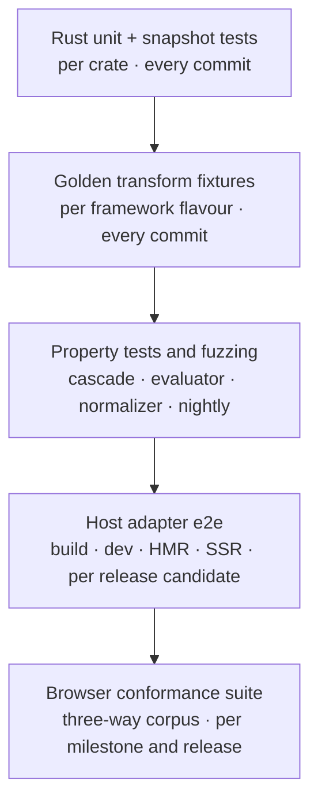

# 15 — Testing and Conformance

**Owns:** the test strategy — Rust unit and snapshot tests, golden transform fixtures, cascade property
tests, fuzzing, determinism checks, the browser computed-style conformance suite, host adapter
end-to-end tests, and codemod tests.
**Depends on:** [00-glossary](./00-glossary.md), [20-decisions](./20-decisions.md) (D-032),
[08-conditions-and-cascade](./08-conditions-and-cascade.md), [10-compiler-architecture](./10-compiler-architecture.md),
the StyleX comparison.

## Test pyramid

## Rust unit and snapshot tests

**KRN-TEST-001** — Every crate MUST test its public behaviour through integration tests (`tests/`) with
inline snapshots (candidate: `insta`). CSS and transformed-code snapshots are product output: a snapshot
change needs the same review as a behaviour change. Heavy crates consolidate their integration tests into
one test binary to keep link times down. Tests run with `cargo nextest`.

## Golden transform fixtures

**KRN-TEST-002** — `packages/kirana/fixtures/transform/<case>/` MUST hold `input.*`, `output.*`,
`output.css` and `diagnostics.json` for each supported source flavour (React, Preact, Solid, Vue,
Svelte, Astro, vanilla). Each diagnostic in the catalogue
([10](./10-compiler-architecture.md#diagnostic-catalogue)) MUST have at least one fixture that triggers
it and one that shows its fix compiling cleanly.

## Cascade property tests

**KRN-TEST-003** — Property-based tests (`proptest`) MUST generate random style sets, condition
sets and merge sequences and assert:

1. build-time merging and the private runtime's `merge` produce the same class set for every sequence;
2. the precedence ladder is a strict total order: antisymmetric, transitive, and independent of input order;
3. longhand expansion followed by merging equals merging the author's intent table
   ([08](./08-conditions-and-cascade.md#merge-semantics)) for every shorthand in the property data;
4. value normalization is idempotent.

Property 1 crosses languages through a checked-in artefact: the Rust suite generates seeded merge vectors
(`packages/kirana/fixtures/merge/vectors.json`) from the build-time merge and fails when the file is stale;
the runtime's Vitest suite replays every vector, shorthand atoms and unfolds included. Property 3 runs over
sequences of sets and removals — box families, border families, `border` and side shorthands, with and
without conditions — and checks that merging the compiled shorthand atoms gives every longhand the value
of the author's intent (D-045); typed shorthands (`flex`, `text-decoration`) are covered by expansion
tests and golden fixtures.

A sampled subset of generated cases also runs in a real browser: the ladder's predicted winner must equal
the computed style.

## Fuzzing

**KRN-TEST-004** — Fuzz targets (candidate: `cargo-fuzz`) MUST exist for:

| Target      | Property checked                                                                                  |
| ----------- | ------------------------------------------------------------------------------------------------- |
| Prefilter   | No panic; never rejects a module that a full parse finds style-bearing (the parse is the oracle). |
| Evaluator   | Terminates within its depth and size limits; never panics on any AST.                             |
| Normalizer  | Idempotent; output reparses in Lightning CSS.                                                     |
| SFC masking | Masked output preserves every original span length and position.                                  |
| CSS writer  | Emitted stylesheets parse in Lightning CSS with no errors.                                        |

## Determinism

**KRN-TEST-005** — CI MUST build the three-way corpus's Kirana port on Linux, macOS and Windows, on x64 and
arm64, with one thread and with all threads, and fail unless the stylesheet, class names and transformed
modules are byte-identical across all runs (KRN-OUT-006).

## Browser conformance suite

**KRN-TEST-006** — The conformance suite MUST compare computed styles, not screenshots, across the three
implementations of the three-way corpus ([14](./14-benchmark-methodology.md#corpora)). Its method is the one
the project used to verify the StyleX port, extended with every gap that let a bug through
(, W2 and W3):

| Dimension         | Coverage                                                                                                                                                                                                                                           |
| ----------------- | -------------------------------------------------------------------------------------------------------------------------------------------------------------------------------------------------------------------------------------------------- |
| Elements          | Every element, paired by tag and `data-slot` in DOM order, re-synchronising across elements only one side renders.                                                                                                                                 |
| Properties        | Layout, box model, borders **including `border-style`**, colours, typography **including `text-wrap-mode`, `text-wrap-style`, `text-decoration-line`, `text-underline-offset`**, opacity, filters, shadows, transforms, cursor, `backdrop-filter`. |
| Pseudo-elements   | `::before` and `::after`: `content`, position, insets, size, background, border.                                                                                                                                                                   |
| States            | At rest; `:hover` and `:focus-visible` on interactive elements; every overlay open; menu rows highlighted by keyboard; checked, disabled and invalid form states.                                                                                  |
| Widths            | 1400 px, 900 px and 390 px — text-wrap differences only appear when text is tight.                                                                                                                                                                 |
| Colour schemes    | System light, system dark, and each mode pinned against the opposite OS setting.                                                                                                                                                                   |
| Motion            | A property sampled every animation frame after each trigger; sequences compared on the same curve rather than row by row.                                                                                                                          |
| Colour comparison | Every colour normalised through a probe element set to `color-mix(in srgb, <colour> 100%, transparent)`, compared with a tolerance of 2/255 per channel.                                                                                           |
| Documents         | Root element computed `color-scheme`, and the documents inside iframes (block viewers).                                                                                                                                                            |

Implementation (`conformance/README.md` in the benchmark repository):

- **Routes** are discovered, never hand-kept: every same-origin link on an app's index page and every
  iframe those pages embed. `--shard i/n` splits the sorted list for parallel CI jobs.
- **One load per route per implementation**: widths change through the viewport and colour schemes through
  `prefers-color-scheme`, in place. Finite animations are read at their end and endless ones at their first
  frame. A route that differs is captured a second time; only differences seen both times count.
- **Arbiters**: against the StyleX port, a difference where Kirana matches the Tailwind original is a
  correction, not a failure (the port was wrong); against the Tailwind original, a difference the StyleX
  port shares with the same value is inherited. The gate is therefore "renders like the port, except where
  it renders like the original".
- **States** run per route with a trigger selector each; a page without the trigger skips the state.

Rules:

- A maintained **expected differences list** records each accepted divergence the arbiters do not
  explain, with its reason. Any other difference fails the suite.
- When the Tailwind twin is the one that is wrong, the fix goes into the twin, keeping the three
  implementations structurally identical.
- Focused conformance cases cover the semantics in [08](./08-conditions-and-cascade.md): shorthand versus
  longhand, `omit` versus `null`, every ladder step, relations (`within`, `after`, `:has`), contextual
  styles against own styles, pseudo-element conditions per direction, container and media ranges, and
  variables defaults versus scoped overrides.

## Host adapter end-to-end tests

**KRN-TEST-007** — Each supported host ([11](./11-integrations.md#bundlers-and-build-tools)) MUST have a
sandbox app tested for: production build, development server start, a scripted style edit updating CSS
through HMR, a token edit re-running affected modules, SSR output where the host supports it, and the
stylesheet entry. The same sandboxes install under npm, pnpm, Yarn (node_modules and Plug'n'Play) and Bun
on Linux, macOS and Windows, plus a WASI-fallback run (experiment E-08).

## Codemod tests

**KRN-TEST-008** — Migration codemods MUST be tested end to end on our shadcn/ui port:

1. `kirana-style migrate stylex` on `packages/ui` and the apps, then a Kirana build, then the conformance suite
   against the StyleX port;
2. `kirana-style migrate tailwind` on the Tailwind twin, then a Kirana build, then the conformance suite against
   the twin;
3. fixture cases for every "reports" item in [06](./06-authoring-api.md#migration-codemods) (custom
   variants, `cn` deletions, width-only borders, wrapper default props), asserting the report is produced
   and nothing is silently guessed.

## Other gates

- The private runtime's size (KRN-DYN-005) is measured on every commit and fails CI above the limit.
- Output size and type cost are recorded in `budgets/budgets.json` and checked on every pull request
  (KRN-BENCH-008): a change to either is committed with the change that causes it.
- The language server is tested by replaying the **editor** corpus and asserting responses and latency
  budgets (KRN-DX-011).
- Lint rules run against fixtures under both Oxlint and ESLint and must report identical results; the
  Biome GritQL plugins run against their ESLint originals and must report the same line, column and
  message (D-079).
